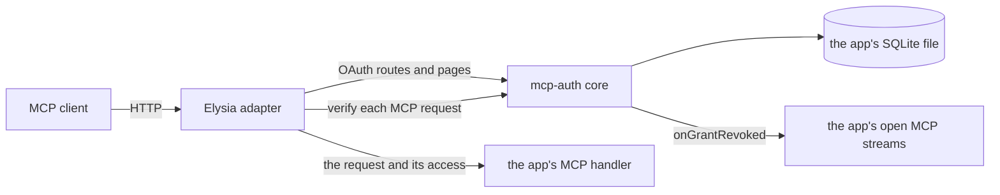

# MCP OAuth server

A hosted MCP client, such as a Claude.ai connector, can reach an app's `/mcp` route only after the
person who runs the app, the owner, lets it in. The owner adds each client by name. The client then
runs the OAuth browser flow, in which the owner logs in with a passkey and allows a set of scopes,
and the client gets tokens. Each MCP request carries a token, and the core's `verify` function turns
it into the access that the app's MCP handler acts on. One package, `@zgeoff/mcp-auth`, serves this
flow for atc, boxxy, pepys and impz. Each app passes in its own scopes, paths, table names and grant
limits. The [package README](../../packages/mcp-auth/README.md) gives the API.

The core is built on better-auth and its OAuth provider and MCP plugins. It exports one handler for
each OAuth route and browser page, each a function from `Request` to `Response`, and never imports
Elysia or an MCP SDK. The Elysia adapter serves those functions at the app's paths. It refuses a
request with a wrong Host header, and a POST to an MCP path with a wrong Origin header, then calls
`verify` before it hands the request to the app. An app on another framework can serve the functions
itself.

## Grants

The core stores each grant, what the owner allows one client in one sign-in, as one row of
better-auth's `user` table. It creates the row when the owner passes the passkey login. The consent
route then writes the grant's scopes and limits into the row, and the token route issues every
access token, refresh token and session against it. Each of those references the row with
`on delete cascade`, so one delete revokes the whole grant, and a refresh that races the delete
fails on the foreign key with 400 `invalid_grant`.
[Decision 0001](../decisions/0001-a-grant-is-a-user-row.md) explains the choice.

The core deletes a grant row, and calls `onGrantRevoked` after the delete commits, in each of these
cases:

- the owner's admin commands, `grants.revoke`, and `clients.remove` for each grant of the client;
- a revoke of a refresh token at the revoke route;
- a refresh token that its own client presents after the core already replaced it, because a reuse
  means the token leaked;
- the app's grant-limits `check`, described under [Tokens](#tokens), returning `revoke`, or stored
  limits that no longer parse;
- `passkeys.reset`, for each row whose sign-in hasn't reached its first token, so a login made with
  a removed passkey can't finish;
- `removeExpired`, which the app runs on a timer, for each row older than `UNUSED_GRANT_MS` with no
  live refresh token: a sign-in that never finished, or a grant whose client stopped refreshing.

A reused refresh token from another client revokes nothing, so a client can't end another client's
grant.

The app ends its open MCP streams on `onGrantRevoked`. That hook fires only in the process that
deleted the row, so a revoke from an admin command, which runs in its own process, never reaches the
server's hook. To cover that case, the app calls `verify` with each open stream's token at least
once per `ACCESS_TOKEN_SECONDS`, the life of an access token, and ends the stream when `verify`
returns null. The core can't enforce this, so a stream whose app skips it stays open after a revoke.

## Tokens

The core issues bearer tokens only: it ignores a client's `DPoP` header and issues a plain token,
and `verify` returns null for any token with a `cnf` claim.
[Decision 0002](../decisions/0002-bearer-tokens-only.md) explains the choice. An access token lasts
`ACCESS_TOKEN_SECONDS`. A refresh token lasts `REFRESH_TOKEN_SECONDS`, and the core replaces it on
each use, with no reuse window.

`verify` reads the token's grant row on every call. It stamps the row's `lastUsedAt` at most once
per `TOUCH_MS`, so a busy stream doesn't write on every request.

An app that needs limits that scopes can't express passes grant limits. impz uses them to limit each
grant to some of its VMs, which it calls imps, and to decide whether the grant may create impz API
tokens. The owner sets the limits on the consent page, and `verify` runs the app's `check` function
on each call. `verify` returns only the scopes that are both in the grant and in `check`'s answer,
so `check` can narrow a grant but never widen it. Write `check` to read nothing but memory or one
indexed row, because it runs on every MCP request. When `check` throws, `verify` throws too and the
grant stays, so a bug in the app's check never revokes grants.

## Service clients

A client with no browser, such as a CI job, can't run the OAuth flow, so the owner lists it in a
service-token file instead. The file holds static tokens, secret digests, or both. A client with a
static token sends it as its bearer token on each MCP request. A client with a digest exchanges its
secret for an access token through the OAuth `client_credentials` grant type. The core's token route
handles that grant type itself, and never passes it to better-auth, because better-auth keeps one
secret per client in its tables, and a rotation needs two. Each service client holds 1 or 2 digests,
so a rotation adds the new digest before it drops the old one.

The core keeps only digests in memory, and compares each presented secret with every stored digest
using `timingSafeEqual`. A token issued for a secret lasts `ISSUED_TOKEN_SECONDS`, has no refresh
token, and lives only in memory, so a restart ends every one. At `ISSUED_TOKEN_CAP` live tokens the
route answers 503 `temporarily_unavailable`, which bounds that memory. `verify` cuts such a token's
scopes to the client's current scopes in the file, so when the app reloads the file with
`replaceServiceTokens`, `verify` narrows live tokens at once. A file that fails to parse leaves the
old one in place.

## Sign-ins

Every client must use PKCE, and dynamic client registration is off, because only the owner adds
clients. A redirect URI uses `https:`, or `http:` on a loopback host. A sign-in and its
authorization code expire after `CODE_SECONDS`, and the owner's browser session after
`SESSION_SECONDS`.

A sign-in's grant row is in the database from the passkey login on. Everything else about a sign-in
in progress is in memory: the request, its count of failed logins and its WebAuthn challenge. The
core also draws a new random secret for better-auth each time the app starts, and better-auth signs
the owner's browser session and each signed login link with it. A restart therefore logs the owner
out and ends every sign-in in progress, the client starts a new one, and `removeExpired` later
deletes the orphaned row.

The core caps the sign-ins in memory: how many wait at once, how many one client holds, and how many
start per minute. The core ends a sign-in at `MAX_FAILURES` failed logins. These caps stand in for
better-auth's rate limit, which is off because it counts by client address, and behind a proxy every
caller would share one address. The login, enroll and consent routes refuse a form post whose
`Origin` header differs from the server's origin.

## Storage

The core runs on the app's own SQLite file, which the app creates with mode 0600 because it holds
token hashes and sessions. At open, the core turns on foreign keys and reads the setting back,
because the cascade that revokes a grant does nothing without them. It refuses to open when a token
or session table lacks its cascading key, or when the app's passkey table lacks a column the core
needs. The core creates the tables it owns and adds their missing columns. It never alters the
passkey table, because an app uses passkeys for more than MCP and passes that table's name in.

An app that runs its own Kysely on the same SQLite connection passes that Kysely to the core, so the
two share one driver lock. [Decision 0003](../decisions/0003-the-core-shares-the-apps-kysely.md)
explains the choice. `close` ends only a Kysely the core built itself.

## Security events

The app passes a `record` callback, and the core and the adapter call it for each request they
refuse. The core records the refusals on its OAuth routes. The adapter records `bad_host`,
`bad_origin`, and `bearer` for a missing or failed token. Neither writes a token, an authorization
code or a line of the service-token file into an event or an error message.
