# Repo sync

Repo sync keeps the files every downstream repo carries a copy of current in each repo.
[`manifest.json`](../../sync/manifest.json) lists them as entries, and the
[repo-sync workflow](../../.github/workflows/repo-sync.yml) delivers them to a downstream repo as
one pull request on the branch `repo-sync/zgeoff-tools`, with one commit for each entry that
changed. A run while that pull request is open updates it, and the pull request merges on green
checks with no review, as [Auto-merge](#auto-merge) describes.
[`repo-sync.yml`](../../sync/repo-sync.yml) is the stub a downstream repo installs to call it. A
merge to `main` here that changes a synced file reaches each repo as that pull request once `main`
is green, as [Delivery](#delivery) describes.

## The sources

The entries name their sources under [`sync/`](../../sync/), and a source can sit elsewhere in the
repo or in [zgeoff/skills](https://github.com/zgeoff/skills):

- [`sync/manifest.json`](../../sync/manifest.json): the entries, which
  `scripts/check-sync-manifest.sh` checks in CI.
- [`sync/repo-sync.yml`](../../sync/repo-sync.yml): the stub that calls the repo-sync workflow at a
  pinned commit.
- [`sync/workflow-callers/`](../../sync/workflow-callers/): workflows that each call a reusable
  workflow in this repo, all opt-in but the repo-sync guard.
- [`sync/skills-pin.json`](../../sync/skills-pin.json): the commit of zgeoff/skills that each skill
  entry copies its text from, as [Skills](#skills) describes.
- [`sync/hooks/`](../../sync/hooks/): the agent hooks' start-up stub and the skill gate's older
  entry point.
- [`sync/pre-push/`](../../sync/pre-push/): the [pre-push baseline](./pre-push-baseline.md) that the
  `pre-push-baseline` entry delivers, and the [memory-cap script](./memory-caps.md).
- [`packages/chex/src/`](../../packages/chex/src/): the docs check scripts that the skill entries
  and the `docs-vision-check` entry deliver, and the check scripts of the `pre-push-baseline` entry.
  [`@zgeoff/chex`](../../packages/chex/README.md) runs the same scripts as `chex <check>`.

## Delivery

```mermaid
flowchart LR
  skills[zgeoff/skills green main] -. zgeoff-skills-sync .-> pin[pin pull request]
  pin --> merge
  merge[merge to tools main] --> main[Main run green]
  main --> dispatch[sync-dispatch]
  dispatch -- zgeoff-tools-sync with the commit --> caller[repo-sync stub in each repo]
  caller --> run[repo-sync run at that commit]
  run --> pr[sync pull request that merges on green]
```



A green `main` is the release gate. When a `Main` push run on `main` passes, the
[sync-dispatch workflow](../../.github/workflows/sync-dispatch.yml) diffs `main` from the green
commit before that run's commit up to the newest green commit. When the diff touches the manifest, a
source that either manifest lists, or a file whose content a repo's pin decides, the workflow sends
a `repository_dispatch` event, `zgeoff-tools-sync`, to every repo that the sync App can reach, with
the newest green commit in `client_payload.sha`. Two green runs that finish in either order cover
every commit between them, because each run checks from the commit before its own. The pin file
counts as a synced source, so a merge that moves it sends the dispatch. The dispatch needs only the
App's contents write.

A green push run on `main` of zgeoff/skills sends this repo a `zgeoff-skills-sync` event with its
commit in `client_payload.sha`. The sync-dispatch workflow then moves `sync/skills-pin.json` to that
commit in one pull request on the `skills-pin` branch, written as the App, with auto-merge on. It
moves the pin only forward along `main` of zgeoff/skills, past both the pin on `main` here and the
one the open pull request holds, so events may arrive in any order. Its merge is a synced change
like any other.

Each repo pins every call to a tools workflow to one commit on `main`, with a `# main` comment, and
never at `main` itself, so a run of a test or doc audit never sees the shared files change under it.
The stub passes the dispatched commit as the workflow's `ref` input, and the run syncs the files of
that commit. The run refuses a `ref` that is not a commit on `main` of tools, because anyone who can
push to the repo can send a dispatch, and GitHub serves a fork's commit through this repository.

The sync pull request also moves every call to a tools workflow in the repo's `.github/workflows/`
to that commit, so its merge leaves the repo on one commit. A pin decides the content of each
reusable workflow, the two files its first step downloads, and the bundle of each step script under
`step-bundles/`, which the download fetches in place of the script. A run with nothing to sync still
opens a pull request that only moves the pins when one of those files differs between the repo's pin
and the commit; otherwise it opens no pull request and moves no pin. A delivered workflow that
differs from its source only by its pin counts as nothing to sync. Renovate never moves these refs:
the shared preset turns its updates off, because it would read the commit as a digest of `main` to
bump.

A run from any other trigger, the stub's daily run, a push that changes the stub, or a manual run,
syncs the newest green commit on `main`. The stub's concurrency group names the dispatched commit,
and the sync job queues every waiting run, so a dispatch of each commit runs. A dispatch that GitHub
drops is lost, and the next daily run delivers what it carried. When the Actions API fails or lists
no green run, the run warns and syncs the commit the repo pins, so that day's run delivers nothing
and the lost change waits for a run that reads the API. A run whose commit is older than any commit
that a workflow on the repo's `main` or on its open sync pull request pins changes nothing, so
dispatches may arrive in any order. A run that cannot read those pins, or cannot tell whether one is
newer, fails rather than guess, and the next run tries again.

The step scripts of a run come from the pinned commit, never from `ref`, so a change to the scripts
reaches a repo once its next sync pull request merges.

When the open sync pull request has a failing check and is more than a day old, the workflow's alarm
job opens one issue for it in the repo, so a red sync never waits unseen. The alarm runs with the
repo's own token, which is why the stub grants `issues: write`, `pull-requests: read`,
`checks: read`, `statuses: read` and `actions: read`. A called workflow can never gain a permission
its caller withholds, so the stub and the alarm job change their permissions together.

## Manifest entries

An entry holds:

- `name` — the branch suffix and the name that `skip` and `include` take.
- `description` — one line, which the workflow writes into the pull request body.
- `files` — `source` (a path in the source repo), `target` (a path in the downstream repo), an
  optional `repo`, `zgeoff/tools` by default or `zgeoff/skills`, that holds the source, an optional
  `mode` such as `0755`, and an optional `except`, the `owner/repo` names of the repos that never
  receive the file. The workflow copies each file verbatim, except that a workflow target's calls to
  `zgeoff/tools` workflows move to the commit the run syncs from, and a Markdown target loses the
  blocks that need a file the repo does not receive.
- `optIn` (optional) — `true` delivers the entry only to a repo whose stub lists it in `include`.
- `build` (optional) — a bash command the workflow runs in the downstream checkout after the copy,
  for a file that is generated from a copied one. The runner has bash, git and jq, and nothing from
  the downstream repo's toolchain is installed, so the command uses those only.
- `scripts` (needed when the `build` writes `package.json` scripts) — each script key the `build`
  writes, with the value it writes, so a check of a sync pull request can hold its `package.json`
  change to those lines. `scripts/check-sync-manifest.sh` runs each `build` on an empty
  `package.json` and fails when the scripts it writes there differ from this field.

A target under `.github/workflows/` needs the line `repo-sync delivers this file from zgeoff/tools`
in its source. Without it, the workflow never overwrites a workflow file the repo wrote itself.
`scripts/check-sync-manifest.sh` checks these rules in CI.

## Workflow callers

Files under [`workflow-callers/`](../../sync/workflow-callers/) are short workflows that each call a
reusable workflow in this repo. Each is an opt-in entry, which a repo lists in the stub's `include`
input. One exception: `workflow-repo-sync-guard` reaches every repo, because every repo's sync pull
request merges on its own, as [Auto-merge](#auto-merge) describes. A caller reads repo-specific
values from repo variables, which its header comment names, since the copy is otherwise verbatim.
`workflow-bun-pr` runs [`bun-checks.yml`](../../.github/workflows/bun-checks.yml), the standard Bun
pull-request checks.

## Skills

The text of each shared Claude skill lives in [zgeoff/skills](https://github.com/zgeoff/skills),
under `skills/<name>/`, and its `skill-<name>` entry delivers it to `.claude/skills/<name>/`. The
run checks out zgeoff/skills at the commit that `sync/skills-pin.json` holds in the tools commit it
syncs, so a repo's sync pull request names both commits. A skill entry is opt-in, so a repo takes
only the skills for the work it holds. One exception: `skill-pr-evidence` reaches every repo,
because every agent that opens a pull request needs it. A repo keeps its own rules for the same area
in a `project-<name>` skill beside it, which repo-sync never touches, and the shared skill tells the
reader to load both. The entry lists every file in its skill folder, since the skill links its
references by relative path; `scripts/check-sync-manifest.sh` fails on a file the entry omits, and
reads zgeoff/skills from the tree that `bun run skills:install` unpacks. The docs-writing and
skill-writing entries also deliver the docs check scripts from this repo.

This repo takes `code-style` and `docs-writing` from the same pin. `bun run skills:install`, which
`bun install` runs, unpacks zgeoff/skills at the pinned commit into the git-ignored
`.zgeoff-skills/<commit>/` and links each skill there from `.claude/skills/`. The tests of the
verb-contract and function-verb lint rules read code-style's role table from that tree.

A reference that fits only some repos, such as one for a language a repo never uses, names the other
repos in its `except`, so they never load it. Every link to it in the entry's Markdown files sits in
a block, which the workflow removes for an excepted repo, and the text outside the block reads whole
without it:

```markdown
<!-- repo-sync needs ./references/rust.md -->

For Rust, read [Rust testing](./references/rust.md).

<!-- repo-sync end -->
```

The path is relative to the Markdown file. `scripts/check-sync-manifest.sh` fails on a link to an
excepted file outside its block. The workflow leaves an excepted file in place, so a repo that holds
a copy from before its `except` removes that copy itself.

## Hooks

Files under [`hooks/`](../../sync/hooks/) are agent hooks, delivered as opt-in entries to
`.claude/hooks/`. Their tests stay in tools. `hook-start` delivers the start-up stub that every hook
entry runs, which runs the hooks from [`@zgeoff/agent-hooks`](../../packages/agent-hooks/README.md)
and installs the package when it is missing, as [Agent hooks](./agent-hooks.md) describes. A repo
takes a hook fix by bumping the package, and the stub changes only when the package's API does. A
repo opts in with the changes that
[Opting in to the agent hooks](../runbooks/downstream-repo-setup.md#opting-in-to-the-agent-hooks)
lists, which repo-sync never touches. `hook-skill-gate` delivers the skill gate's older entry point,
which runs the gate from `@zgeoff/skill-gate`.

The pre-push baseline is an entry of its own kind, which
[The pre-push baseline](./pre-push-baseline.md) describes.

## Retired files

A file that an earlier manifest delivered and the current one no longer lists is retired, and the
workflow deletes the repo's copy in its own commit, `retired-files`. It deletes a copy only when the
copy matches a version of a source that tools delivered to that path, so a file the repo wrote
itself or edited after the sync stays. A renamed file is the exception: when its source moved to a
source that the same entry still delivers, and the run wrote the new target, the old copy goes even
when the repo edited it, since the sync overwrites the file at its new path. git's rename detection
finds the move in this repo's history, so a repo that missed syncs since the move loses the old copy
too.

A retired file also stays while its entry is still in the manifest and the run did not sync that
entry, because the entry's current files can still need it. That covers an entry the repo skips or
leaves out of `include`, and an entry that failed. A retired file of an entry that the manifest no
longer holds stays when the repo lists that entry in `skip`.
[`scripts/remove-retired-sync-files.sh`](../../scripts/remove-retired-sync-files.sh) reads the
earlier manifests from this repo's history, and the versions of a zgeoff/skills source from that
repo's history, so the workflow checks out the full history of both.

## Auto-merge

The workflow turns on GitHub's auto-merge, with a squash, for the pull request it opens or updates,
so the pull request merges once the repo's required checks pass. Its files are text that tools
already reviewed, so it needs no review in the repo. The workflow turns auto-merge on only when the
pull request merges into the branch the run synced from, and the branch changes nothing but the
targets the run copied, the retired copies it removed, and `package.json` changed only by the
scripts that an entry's `scripts` field declares. On any other change it warns and leaves auto-merge
off, and the pull request waits for review. Auto-merge binds to the head commit that the run
checked. A repo whose settings disallow auto-merge gets a warning, and its sync pull requests wait
for review. GitHub refuses auto-merge for a pull request that can merge at once, such as one in a
repo whose rules require no check, so that pull request waits for review too.

GitHub keeps auto-merge on through a later push by anyone with write access, the workflow's own
force push included, so two steps keep an unchecked commit from merging on its own. The workflow
turns auto-merge off before it pushes, so a run that stops before its check leaves the pull request
waiting for review. The `workflow-repo-sync-guard` entry delivers a workflow that runs on each push
to the sync branch and turns auto-merge off when the pusher is not the pull request's author, the
repo-sync App. The guard races the repo's required checks: a required check that passes on the
pushed commit before the guard runs lets GitHub merge it.

## The sync branch

The sync branch is force-pushed on every run, so a commit a person adds to it is lost on the next
run, and the push turns the pull request's auto-merge off. Edit the source in tools instead. An
entry that fails, through a workflow conflict or its build, is left out of the pull request, and the
run fails after the other entries sync.
