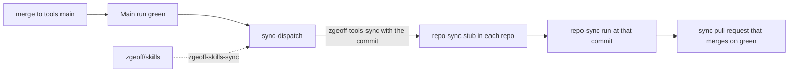

# Repo sync

Repo sync keeps the files every downstream repo carries a copy of current in each repo.
[`manifest.json`](../../sync/manifest.json) lists them as entries, and the
[repo-sync workflow](../../.github/workflows/repo-sync.yml) delivers them to a downstream repo as
one pull request on the branch `repo-sync/zgeoff-tools`, with one commit for each entry that
changed. A run while that pull request is open updates it, and the pull request merges on green
checks with no review, as [Auto-merge](#auto-merge) describes.
[`repo-sync.yml`](../../sync/repo-sync.yml) is the stub a downstream repo installs to call it. A
merge to `main` here that changes a synced file reaches each repo as that pull request once `main`
is green, as [Delivery](#delivery) describes.

## Delivery



A green `main` is the release gate. When a `Main` push run on `main` passes, the
[sync-dispatch workflow](../../.github/workflows/sync-dispatch.yml) compares the commit with the
last green commit before it. When the change touches the manifest or a source that either manifest
lists, the workflow sends a `repository_dispatch` event, `zgeoff-tools-sync`, to every repo that the
sync App can reach, with the commit in `client_payload.sha`. A `zgeoff-skills-sync` event from
zgeoff/skills sends the newest green commit with no check. The dispatch needs only the App's
contents write.

Each repo pins every call to a tools workflow to one commit on `main`, with a `# main` comment, and
never at `main` itself, so a run of a test or doc audit never sees the shared files change under it.
The stub passes the dispatched commit as the workflow's `ref` input, and the run syncs the files of
that commit. The run refuses a `ref` that is not a commit on `main` of tools, because anyone who can
push to the repo can send a dispatch, and GitHub serves a fork's commit through this repository.

The sync pull request also moves every call to a tools workflow in the repo's `.github/workflows/`
to that commit, so its merge leaves the repo on one commit. A run with nothing to sync opens no pull
request and moves no pin. Renovate never moves these refs: the shared preset turns its updates off,
because it would read the commit as a digest of `main` to bump.

A run from any other trigger, the stub's daily run, a push that changes the stub, or a manual run,
syncs the pinned commit. Runs of one repo queue rather than cancel, and a run whose commit is older
than the commit the open sync pull request pins leaves that pull request alone.

The step scripts of a run come from the pinned commit, never from `ref`, so a change to the scripts
reaches a repo once its next sync pull request merges.

When the open sync pull request has a failing check and is more than a day old, the workflow's alarm
job opens one issue for it in the repo, so a red sync never waits unseen. The alarm runs with the
repo's own token, which is why the stub grants `issues: write`, `pull-requests: read`,
`checks: read` and `statuses: read`.

## Manifest entries

An entry holds:

- `name` — the branch suffix and the name that `skip` and `include` take.
- `description` — one line, which the workflow writes into the pull request body.
- `files` — `source` (a path in this repo), `target` (a path in the downstream repo), an optional
  `mode` such as `0755`, and an optional `except`, the `owner/repo` names of the repos that never
  receive the file. The workflow copies each file verbatim, except that a workflow target's calls to
  `zgeoff/tools` workflows move to the commit the run syncs from, and a Markdown target loses the
  blocks that need a file the repo does not receive.
- `optIn` (optional) — `true` delivers the entry only to a repo whose stub lists it in `include`.
- `build` (optional) — a bash command the workflow runs in the downstream checkout after the copy,
  for a file that is generated from a copied one. The runner has bash, git and jq, and nothing from
  the downstream repo's toolchain is installed, so the command uses those only.
- `scripts` (needed when the `build` writes `package.json` scripts) — each script key the `build`
  writes, with the value it writes, so a check of a sync pull request can hold its `package.json`
  change to those lines. `scripts/check-sync-manifest.sh` runs each `build` on an empty
  `package.json` and fails when the scripts it writes there differ from this field.

A target under `.github/workflows/` needs the line `repo-sync delivers this file from zgeoff/tools`
in its source. Without it, the workflow never overwrites a workflow file the repo wrote itself.
`scripts/check-sync-manifest.sh` checks these rules in CI.

## Workflow callers

Files under [`workflow-callers/`](../../sync/workflow-callers/) are short workflows that each call a
reusable workflow in this repo. Each is an opt-in entry, which a repo lists in the stub's `include`
input. One exception: `workflow-repo-sync-guard` reaches every repo, because every repo's sync pull
request merges on its own, as [Auto-merge](#auto-merge) describes. A caller reads repo-specific
values from repo variables, which its header comment names, since the copy is otherwise verbatim.
`workflow-bun-pr` runs [`bun-checks.yml`](../../.github/workflows/bun-checks.yml), the standard Bun
pull-request checks.

## Skills

Files under [`skills/`](../../sync/skills/) are the shared base of a Claude skill, each delivered by
its `skill-<name>` entry to `.claude/skills/<name>/`. A skill entry is opt-in, so a repo takes only
the skills for the work it holds. One exception: `skill-pr-evidence` reaches every repo, because
every agent that opens a pull request needs it. The code-style base lives in this repo's own
[`.claude/skills/code-style/`](../../.claude/skills/code-style/), because this repo's agents load it
there and the verb-contract lint rule's test reads its role table from it. A repo keeps its own
rules for the same area in a `project-<name>` skill beside it, which repo-sync never touches, and
the shared skill tells the reader to load both. The entry lists every file in its skill folder,
since the skill links its references by relative path; `scripts/check-sync-manifest.sh` fails on a
file the entry omits. A skill's tests sit beside its scripts and stay in tools.

A reference that fits only some repos, such as one for a language a repo never uses, names the other
repos in its `except`, so they never load it. Every link to it in the entry's Markdown files sits in
a block, which the workflow removes for an excepted repo, and the text outside the block reads whole
without it:

```markdown
<!-- repo-sync needs ./references/rust.md -->

For Rust, read [Rust testing](./references/rust.md).

<!-- repo-sync end -->
```

The path is relative to the Markdown file. `scripts/check-sync-manifest.sh` fails on a link to an
excepted file outside its block. The workflow leaves an excepted file in place, so a repo that holds
a copy from before its `except` removes that copy itself.

## Hooks

Files under [`hooks/`](../../sync/hooks/) are Claude Code hooks, delivered as opt-in entries to
`.claude/hooks/<name>/`. Their tests stay in tools. `hook-skill-gate` delivers the skill gate's
entry point, a file that runs the gate from
[`@zgeoff/skill-gate`](../../packages/skill-gate/README.md). The gate denies an edit until the
session has loaded every skill the path needs, and a call to a gated tool until the session has
loaded its skills and read its reference files. The package README describes what it allows, blocks
and warns on. The repo takes a gate fix by bumping the package, and the entry point changes only
when the package's API does. A repo opts in with four changes, which repo-sync never touches, as
[Opting in to the skill gate](../runbooks/downstream-repo-setup.md#opting-in-to-the-skill-gate)
lists.

The pre-push baseline is an entry of its own kind, which
[The pre-push baseline](./pre-push-baseline.md) describes.

## Retired files

A file that an earlier manifest delivered and the current one no longer lists is retired, and the
workflow deletes the repo's copy in its own commit, `retired-files`. It deletes a copy only when the
copy matches a version of a source that tools delivered to that path, so a file the repo wrote
itself or edited after the sync stays. A renamed file is the exception: when its source moved to a
source that the same entry still delivers, and the run wrote the new target, the old copy goes even
when the repo edited it, since the sync overwrites the file at its new path. git's rename detection
finds the move in this repo's history, so a repo that missed syncs since the move loses the old copy
too.

A retired file also stays while its entry is still in the manifest and the run did not sync that
entry, because the entry's current files can still need it. That covers an entry the repo skips or
leaves out of `include`, and an entry that failed. A retired file of an entry that the manifest no
longer holds stays when the repo lists that entry in `skip`.
[`scripts/remove-retired-sync-files.sh`](../../scripts/remove-retired-sync-files.sh) reads the
earlier manifests from this repo's history, so the workflow checks out the full history.

## Auto-merge

The workflow turns on GitHub's auto-merge, with a squash, for the pull request it opens or updates,
so the pull request merges once the repo's required checks pass. Its files are text that tools
already reviewed, so it needs no review in the repo. The workflow turns auto-merge on only when the
pull request merges into the branch the run synced from, and the branch changes nothing but the
targets the run copied, the retired copies it removed, and `package.json` changed only by the
scripts that an entry's `scripts` field declares. On any other change it warns and leaves auto-merge
off, and the pull request waits for review. Auto-merge binds to the head commit that the run
checked. A repo whose settings disallow auto-merge gets a warning, and its sync pull requests wait
for review. GitHub refuses auto-merge for a pull request that can merge at once, such as one in a
repo whose rules require no check, so that pull request waits for review too.

GitHub keeps auto-merge on through a later push by anyone with write access, the workflow's own
force push included, so two steps keep an unchecked commit from merging on its own. The workflow
turns auto-merge off before it pushes, so a run that stops before its check leaves the pull request
waiting for review. The `workflow-repo-sync-guard` entry delivers a workflow that runs on each push
to the sync branch and turns auto-merge off when the pusher is not the pull request's author, the
repo-sync App. The guard races the repo's required checks: a required check that passes on the
pushed commit before the guard runs lets GitHub merge it.

## The sync branch

The sync branch is force-pushed on every run, so a commit a person adds to it is lost on the next
run, and the push turns the pull request's auto-merge off. Edit the source in tools instead. An
entry that fails, through a workflow conflict or its build, is left out of the pull request, and the
run fails after the other entries sync.
