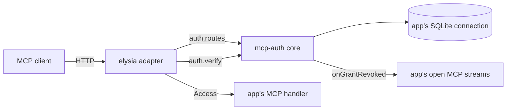

# Shared MCP OAuth server

- **Status:** draft

Four apps, atc, boxxy, pepys and impz, each run their own copy of an OAuth server that lets a hosted
MCP client, such as a Claude.ai connector, reach the app's `/mcp` route. `@zgeoff/mcp-auth` replaces
the four copies with one package. Each app keeps only its own scopes, paths, table names, grant
limits and MCP tools.

The package has these entry points:

- **The core,** `@zgeoff/mcp-auth`, built on better-auth with its OAuth provider and MCP plugins. It
  holds the OAuth routes and pages, passkey login for the owner, pre-registered clients, service
  tokens and grant revoke.
- **The adapter,** `@zgeoff/mcp-auth/elysia`, which serves the core's routes in an Elysia app.
- **The test helpers,** `@zgeoff/mcp-auth/testing`.

## Shape

The core answers each OAuth route and each browser page as a function from `Request` to `Response`.
The adapter serves those functions at the app's paths, checks the Host and Origin headers, and calls
`verify` on each MCP request before it hands the request to the app.

| Doc                                | Part                                                                                                |
| ---------------------------------- | --------------------------------------------------------------------------------------------------- |
| [core.md](./core.md)               | the core and the test helpers: opening the server, the handle, service tokens and the passkey table |
| [grants.md](./grants.md)           | the grant row, grant limits, and revoke                                                             |
| [elysia.md](./elysia.md)           | the adapter                                                                                         |
| [moving-apps.md](./moving-apps.md) | the database migration that each app runs once, when it starts to use the package                   |

## Words

- **Owner:** the person who runs an app. The owner enrolls a passkey, adds each client, and allows
  or denies each sign-in.
- **Client:** an MCP client that the owner adds by name before it can sign in.
- **Sign-in:** one run of the OAuth browser flow, from the authorize request to the exchange of the
  authorization code for tokens. The owner's passkey login is one step of it.
- **Grant:** what the owner allows one client in one sign-in, until a revoke ends it.
- **Handle:** the object that `openMCPAuth` returns.
- **Bearer token:** a token that works for whoever holds it. A DPoP-bound token, from
  [RFC 9449](https://www.rfc-editor.org/rfc/rfc9449), carries a `cnf` claim that ties it to a key,
  and works only with a proof made with that key.
- **Service token:** a fixed token that the owner writes into a file, for a client that cannot run
  the browser flow.
- **Grant limits:** limits past the scopes that an app puts on a grant. impz limits a grant to some
  imps, its VMs, and decides whether the grant may make imp tokens, the API tokens of impz.

## Decisions

- **A grant is a `user` row, and revoke is one cascading delete.** better-auth runs a refresh as
  separate statements with no transaction: it marks the old refresh token used, then inserts the new
  tokens. A revoke that deletes the grant's token rows can commit between those statements, and the
  new tokens survive it. When every token references the grant's `user` row with
  `on delete cascade`, the delete of that row removes the tokens that exist, and the foreign key
  refuses the tokens that come after.
- **The app passes the full name of each table.** Apps use passkeys for more than MCP, so the core
  can work on a passkey table that the app already has, under the app's own name for it.
- **The core keeps every check of the four copies.** It has the refusal of DPoP-bound tokens from
  pepys and impz, the end of a grant on a reused refresh token from impz, and the service tokens
  from atc.
- **The core issues bearer tokens only.** The token route drops a `DPoP` header, so a client that
  sends DPoP still gets a token, as RFC 9449 allows. The core never checks a DPoP proof, so `verify`
  refuses any token with a `cnf` claim.
- **The owner approves each new impz grant with a passkey,** on the same login and consent pages as
  the other apps. On the consent page, the owner picks the scopes and the imps. A grant that an imp
  token approved before impz moved keeps its check against that token until the grant ends.
- **A revoke made in another process reaches an open MCP stream within 15 minutes.**
  `onGrantRevoked` fires only in the process that revokes, such as an admin command. An access token
  lives 15 minutes, and each open stream calls `verify` again within that time.
- **The adapter targets Elysia 2.** An app on Elysia 1 moves to Elysia 2 before it uses the adapter.

## Out of scope

- atc's event subscriptions, its webhook delivery and its terminal viewer. They stay in atc and use
  `verify`, `findClientScopes` and `onGrantRevoked`.
- boxxy's public listener, which decides which paths reach the routes. It stays in boxxy.
- The admin CLI commands. Each app keeps its own commands, which use `openMCPAuthAdmin`.
- A second resource per server. Each server serves one `/mcp` resource.

## Open questions

- **Is `@zgeoff/mcp-auth` public on npm?** The owner settles it. Until then, the package is built as
  a public package, and its first publish waits.
