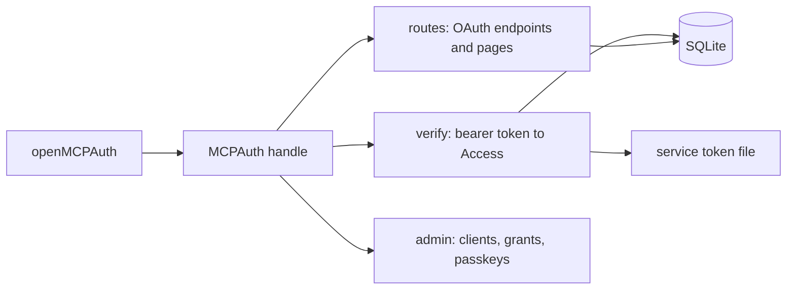

# The mcp-auth core

- **Status:** agreed

`@zgeoff/mcp-auth` runs the OAuth server of one app on better-auth. The app opens it on its own
SQLite database and gets back a handle that holds the route functions, the token check and the admin
calls. `@zgeoff/mcp-auth/testing` holds the helpers that each app's tests use. The
[README](./README.md#words) defines the words this doc uses, and [grants.md](./grants.md) covers how
the core stores, limits and revokes a grant.

## Shape



## Contracts

### Opening the server

The app opens the server once at start, on a `bun:sqlite` connection that the app owns, or on the
app's own Kysely over that connection. The examples in this doc show pepys, an app with read and
write scopes.

```ts
const auth = await openMCPAuth({
  database: sqlite, // the app opens it, and closes it after auth.close(); an app with its own Kysely passes that
  origin: 'https://pepys.example.com',
  productName: 'pepys', // shown on the login, enroll and consent pages
  scopes: ['read', 'write'],
  paths: DEFAULT_PATHS,
  tables: { passkey: 'pepys_passkey', enrollmentToken: 'pepys_enrollment_token' },
  serviceTokens: { prefix: 'pepyss_', file }, // optional; see Service tokens
  clock: { now: () => Date.now() },
  security: { record: (event) => log.info(formatSecurityEvent(event)) },
  onGrantRevoked: (grantID) => revocations.abort(grantID),
});
// → MCPAuth<'read' | 'write', null>; Limits is null because pepys passes no grantLimits
```

An admin command opens the same database with no origin, and gets only the admin calls:

```ts
const admin = await openMCPAuthAdmin({ database: sqlite, scopes, tables, clock, onGrantRevoked });
// → MCPAuthAdmin
```

```ts
// mcp-auth core
interface MCPAuthAdminOptions<Scope extends string> {
  // A bun:sqlite Database that no other Kysely uses: the core builds its own Kysely over it.
  // The app's own Kysely when one runs on the connection: the core runs every statement and
  // transaction through it, so they share its driver lock.
  readonly database: Database | Kysely<any>;
  readonly scopes: readonly Scope[]; // the core adds offline_access
  readonly tables: MCPAuthTables;
  readonly clock: Clock;
  readonly onGrantRevoked: (grantID: GrantID) => void; // after the delete commits
}

interface MCPAuthOptions<Scope extends string, Limits> extends MCPAuthAdminOptions<Scope> {
  readonly origin: string; // the issuer
  readonly productName: string;
  readonly paths: MCPAuthPaths;
  readonly serviceTokens?: { readonly prefix: string; readonly file: ServiceTokenFile<Scope> };
  readonly grantLimits?: GrantLimits<Limits>; // see grants.md#grant-limits
  readonly security: SecuritySink;
}

// An app that serves other paths passes its own object of this shape.
const DEFAULT_PATHS = {
  browser: {
    authorize: '/oauth2/authorize',
    login: '/login',
    enroll: '/enroll',
    consent: '/consent',
    error: '/error',
  },
  machine: {
    mcp: '/mcp', // `${origin}/mcp` is the resource that every token names
    root: '/', // MCP answers at the bare origin too
    token: '/oauth2/token',
    revoke: '/oauth2/revoke',
    authorizationServerMetadata: '/.well-known/oauth-authorization-server',
    resourceMetadata: '/.well-known/oauth-protected-resource',
    mcpResourceMetadata: '/.well-known/oauth-protected-resource/mcp',
  },
} satisfies MCPAuthPaths;

interface MCPAuthTables {
  readonly passkey: string; // owned by the app; see Passkey table
  readonly enrollmentToken: string; // owned by the core: token_hash, created_at, expires_at
}

// The clock for the times the core stamps itself: sign-ins in progress,
// enrollments, lastUsedAt and removeExpired. better-auth stamps token, code
// and session expiries from Date.now().
interface Clock {
  now(): number; // ms since the epoch
}

interface SecuritySink {
  record(event: SecurityEvent): void;
}

type SecurityEvent = {
  readonly kind:
    | 'authorize_started'
    | 'authorize_invalid'
    | 'owner_auth'
    | 'consent'
    | 'token_exchange'
    | 'bearer'
    | 'bad_host'
    | 'bad_origin';
  readonly outcome: 'accepted' | 'rejected' | 'succeeded' | 'failed' | 'allowed' | 'denied';
  readonly reason?: string; // a fixed code, such as 'rate_limited' or 'invalid_grant'
  readonly path: string;
  readonly requester: Requester;
  readonly client?: { readonly id: OAuthClientID; readonly name: string };
  readonly correlationID?: CorrelationID; // the same for every event of one sign-in
};

// The app builds it from the request, in the readRequester it gives the adapter.
interface Requester {
  readonly socketAddress: string | null;
  readonly connectingIP: {
    readonly address: string;
    readonly provenance: 'trusted' | 'unverified';
  } | null; // 'trusted' only when the socket's peer is a proxy the app lists
  readonly userAgent: string | null;
}
```

### The handle

```ts
// mcp-auth core
interface MCPAuthAdmin {
  readonly clients: {
    list(): Promise<ClientView[]>;
    add(name: string, redirectURIs: readonly string[]): Promise<ClientView>;
    readByName(name: string): Promise<ClientView[]>; // every client whose stored name cleans to `name`
    update(clientID: OAuthClientID, redirectURIs: readonly string[]): Promise<ClientView>;
    remove(clientID: OAuthClientID): Promise<number>; // the number of grants it revoked
  };
  readonly grants: {
    list(): Promise<GrantView[]>; // grants with a live refresh token
    revoke(grantID: GrantID): Promise<boolean>; // false when no grant row has the ID
  };
  readonly passkeys: {
    createEnrollmentToken(): Promise<string>; // shown once; the core stores its hash
    list(): Promise<PasskeyView[]>;
    remove(id: PasskeyID): Promise<void>;
    reset(): Promise<void>; // removes every passkey, and the grant row of each sign-in in progress
  };
  readonly removeExpired: () => Promise<void>; // the app runs it on a timer
  readonly close: () => Promise<void>; // leaves the connection open, and the app's Kysely running
}

interface MCPAuth<Scope extends string, Limits> extends MCPAuthAdmin {
  readonly resource: string; // `${origin}${paths.machine.mcp}`
  readonly issuer: string; // origin
  readonly paths: MCPAuthPaths;
  readonly routes: MCPAuthRoutes;

  // Null for an unknown, expired or revoked token, and for a DPoP-bound one.
  // A token with the service prefix is checked against the file, any other
  // against the database. Throws when the app's GrantLimits.check throws.
  readonly verify: (bearer: string) => Promise<Access<Scope, Limits> | null>;

  // The scopes a client holds now: a service client's from the file, an OAuth
  // client's from its live grants. Null when it holds none.
  readonly findClientScopes: (clientID: string) => Promise<readonly Scope[] | null>;
}

// One function per OAuth route and page. The adapter serves each at its path,
// and serves the mcp, root and mcpResourceMetadata paths itself.
type MCPAuthRoutes = Record<
  | 'authorize'
  | 'login'
  | 'enroll'
  | 'consent'
  | 'error'
  | 'token'
  | 'revoke'
  | 'authorizationServerMetadata'
  | 'resourceMetadata',
  (request: Request, requester: Requester) => Promise<Response>
>;

type Access<Scope extends string, Limits> =
  | {
      readonly kind: 'oauth';
      readonly grantID: GrantID;
      readonly clientID: OAuthClientID;
      readonly clientName: string;
      readonly scopes: readonly Scope[]; // after GrantLimits.check
      readonly limits: Limits | null; // null when the app has no grantLimits
    }
  | {
      readonly kind: 'service';
      readonly clientID: `service:${string}`; // never equals an OAuth client ID
      readonly clientName: `service:${string}`;
      readonly scopes: readonly Scope[];
    };

interface ClientView {
  readonly clientID: OAuthClientID;
  readonly name: string;
  readonly redirectURIs: readonly string[];
  readonly createdAt: string;
}

interface GrantView {
  readonly grantID: GrantID;
  readonly clientID: OAuthClientID;
  readonly clientName: string;
  readonly scopes: readonly string[];
  readonly approvedBy: ApprovedBy; // see grants.md
  readonly createdAt: string;
  readonly lastUsedAt: string | null;
}

interface PasskeyView {
  readonly id: PasskeyID;
  readonly createdAt: string;
  readonly lastUsedAt: string | null;
}

class MCPAuthError extends Error {
  readonly code:
    | 'conflict' // a client name already taken
    | 'not-found' // update or remove of an unknown client ID
    | 'invalid-client-name' // empty after the core cleans it
    | 'invalid-redirect-uri'
    | 'invalid-setup'; // at open: foreign keys off, a missing column or key, a resource mismatch
}
```

`GrantID`, `OAuthClientID`, `PasskeyID` and `CorrelationID` are tagged strings.

### Service tokens

Give a client that cannot run the browser flow, such as a CI job, a service token. The owner writes
each token into a file. The app reads the file at start, unwraps the result, and passes the file to
`openMCPAuth`.

```ts
const parsed = parseServiceTokenFile(text, { prefix: 'pepyss_', scopes: ['read', 'write'] });
// → { ok: true, file: { resource: 'https://pepys.example.com/mcp', clients: [{ name: 'ci', scopes: ['read'], tokens: ['pepyss_…'] }] } }
//   or { ok: false, reason: 'a token must be pepyss_ followed by 32 or more of A-Z, a-z, 0-9, _ and -' }
```

The file keys its clients by name. The parsed result lists them, each with its name:

```json
{
  "resource": "https://pepys.example.com/mcp",
  "clients": {
    "ci": { "scopes": ["read"], "tokens": ["pepyss_<32 or more characters>"] }
  }
}
```

### Passkey table

The app owns the passkey table. It may keep more columns in the table, each nullable or with a
default. The core reads and writes only these columns. When the table is missing, the core creates
it with them:

```text
<tables.passkey>
  id            text primary key   the credential ID
  public_key    text               base64url
  counter       integer
  transports    text               JSON array
  created_at    text
  last_used_at  text null
```

### Test helpers

```ts
const { accessToken, refreshToken, grantID, clientID } = await authorizeTestClient(auth, {
  scopes: ['read'],
  consentFields: new URLSearchParams({ imp: 'web-*' }), // optional; the form fields that the app's grant limits read
});
```

`authorizeTestClient` drives `auth.routes` through a whole sign-in, with a stub WebAuthn
authenticator in place of the owner's passkey. `@zgeoff/mcp-auth/testing` also exports an in-memory
database, the stub authenticator, a stub clock, and seeders for clients, grants, passkeys and
enrollment tokens. Each seeder writes through the core's own functions. The in-memory database is
`new Database(':memory:')` under `@zgeoff/kysely-bun-sqlite`, which the core uses too. A test that
steps past a token's life sets the system time with `bun:test`, since better-auth reads
`Date.now()`.

## Constraints

### Storage

- The core runs `PRAGMA foreign_keys = ON` on the connection, reads it back, and throws
  `invalid-setup` when it reads 0. It does so through the app's Kysely when the app passes one.
- An app whose own Kysely runs on the same connection passes that Kysely as `database`. A second
  Kysely over one connection has a driver lock of its own, so a core statement can run inside an app
  transaction, and the app's rollback undoes it, such as a revoke.
  [0003](../../decisions/0003-the-core-shares-the-apps-kysely.md)
- The core ends only a Kysely it built itself. `close` leaves the app's Kysely running.
- `openMCPAuth` throws `invalid-setup` when a token or session table lacks its cascading `userId`
  key, or when the passkey table lacks a column the core needs.
- At open, the core creates the tables it owns and adds their missing columns. It never adds a
  column to the app's passkey table.
- Once an app has run the migration in [moving-apps.md](./moving-apps.md), the app's own code never
  changes the core's tables.
- The app creates the database file with mode 0600, since the file holds token hashes and sessions.

### Tokens and sign-in

- An access token expires after 15 minutes.
- A refresh token expires after 30 days, and the core replaces it on each use, with no reuse window.
- An authorization code and a sign-in in progress expire after 10 minutes. The owner's browser
  session expires after 30 minutes.
- The token route drops a `DPoP` header before better-auth reads the request. `verify` returns null
  for a token with a `cnf` claim. The metadata documents list no DPoP fields.
- At most 16 sign-ins wait at once, at most 3 for one client, and at most 10 start per minute. The
  5th failed passkey login ends the sign-in, and the client starts a new one.
- The login, enroll and consent routes refuse a form post whose `Origin` header differs from
  `origin`.
- better-auth telemetry is off and its rate limit is off. Its secret is drawn at each open, so a
  restart ends the sign-ins in progress.

### Clients and service tokens

- `clients.add` and `clients.update` accept a redirect URI that uses `https:`, or `http:` on a
  loopback host. They refuse a URI with a fragment or with user info.
- Dynamic client registration is off, and every client must use PKCE.
- `clients.add` cleans a name before it stores it: it turns each run of whitespace into one space,
  removes control characters, trims the ends, and cuts the name to 100 code points.
- `clients.update` and `clients.remove` take a client ID, the `clientID` of a `ClientView`. An old
  database can hold two names that clean alike, so a name does not pick one client. `readByName`
  cleans the name it gets, and returns each client whose stored name cleans to the same text.
  `normalizeClientName` is exported for an app that cleans a name itself.
- `openMCPAuth` throws `invalid-setup` when the `resource` of the service token file is not
  `auth.resource`.
- The core compares the SHA-256 digest of a presented service token with every stored digest using
  `timingSafeEqual`, and keeps only digests in memory. Each service client holds 1 or 2 tokens.
- `grants.list` never lists a service client.

### Boundaries

- The core records the security events of `auth.routes`. The adapter records `bearer`, `bad_host`
  and `bad_origin`, as [elysia.md](./elysia.md) says.
- The core never writes a token, a code, or a line of the service token file into an event or an
  error message.
- The core never imports Elysia or an MCP SDK.

## Builder decides

- The internal module layout, and which helpers the core exports beyond the contracts above.
- The markup and styling of the pages, within the product name and the fields the contracts set.
- The wording of each error and security-event message.
- How the core holds the sign-ins in progress and the enrollment challenges in memory.
- The arguments of each seeder, and the test layout, within the `testing` skill.
