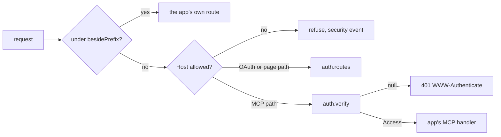

# The Elysia adapter

- **Status:** agreed

`@zgeoff/mcp-auth/elysia` serves the core's routes in the app's Elysia app. It refuses a request
with the wrong Host or Origin header, and checks the bearer token of each MCP request before it
hands the request to the app's MCP handler. [core.md](./core.md) holds the core and its handle,
`auth`.

## Shape



The OAuth and page paths are every path in `auth.paths` but the MCP paths. The MCP paths are
`auth.paths.machine.mcp` and `auth.paths.machine.root`.

## Contracts

```ts
app.use(
  createMCPHTTPApp({
    auth,
    hosts: new Set(['pepys.example.com']),
    origins: new Set(['https://pepys.example.com']),
    readRequester, // builds a Requester from the socket address, CF-Connecting-IP and User-Agent
    security, // the same SecuritySink the core takes
    mcp: { fetch: (request, access) => mcpHandler.fetch(request, access) },
    besidePrefix: '/api',
  }),
);
```

```ts
// mcp-auth elysia
interface MCPHTTPAppOptions<Scope extends string, Limits> {
  readonly auth: MCPAuth<Scope, Limits>;
  readonly hosts: ReadonlySet<string>; // the Host header values the app answers to
  readonly origins: ReadonlySet<string>; // the Origin header values a POST may carry
  readonly readRequester: (request: Request) => Requester;
  readonly security: SecuritySink;
  readonly mcp: {
    readonly fetch: (request: Request, access: Access<Scope, Limits>) => Promise<Response>;
  };

  // Paths under this prefix belong to the app. The adapter serves none of
  // them, and checks neither their Host nor their Origin header.
  readonly besidePrefix: string;
}
```

## Constraints

- The adapter answers MCP at both MCP paths. Both name the one resource, `auth.resource`.
- The adapter serves the resource metadata at `resourceMetadata` and at `mcpResourceMetadata`, since
  an MCP client looks for it at either path.
- The adapter refuses a POST whose Origin header is not in `origins`. A GET needs no Origin header.
- The adapter records a `bad_host`, `bad_origin` or `bearer` security event for each request it
  refuses.
- The adapter answers no unknown path, so the app it is mounted on gives its own 404.
- An app that keeps an MCP stream open calls `auth.verify` with the stream's token at least every 15
  minutes, the life of an access token. When `verify` returns null, the app ends the stream.

## Builder decides

- How the adapter registers its routes and hooks with Elysia.
- The body of each refusal.
