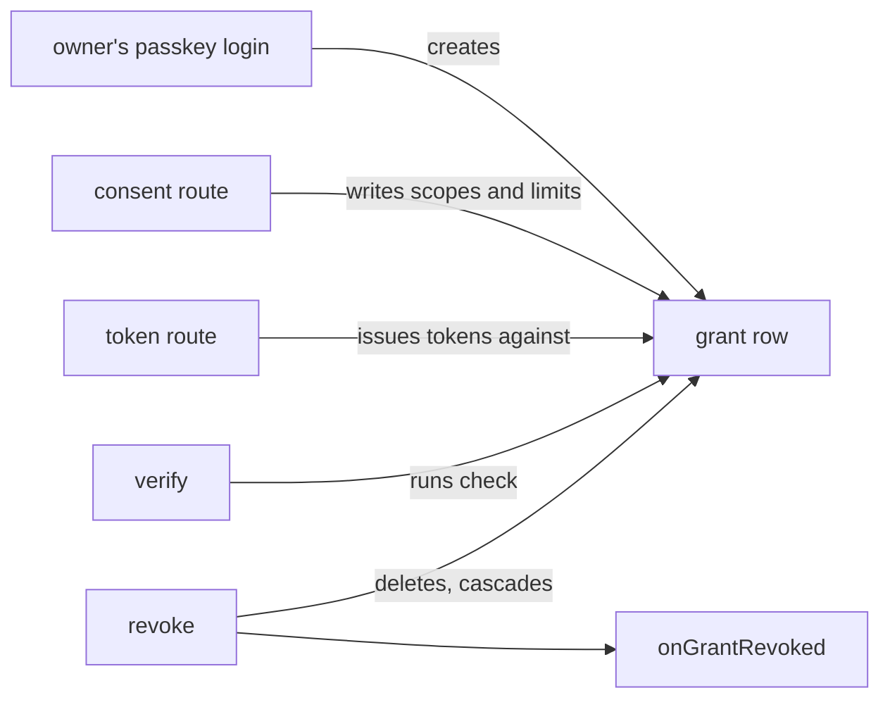

# Grants

- **Status:** agreed

The core stores each grant as one row of better-auth's `user` table. Every token and session of the
grant references that row, so one delete revokes the grant. An app can narrow a grant past its
scopes with grant limits, which the core checks each time `verify` reads a token of the grant. The
[README](./README.md#words) defines the words this doc uses, and [core.md](./core.md) holds the
handle.

## Shape



## Contracts

### The grant row

The core creates a grant row when the owner passes the passkey login, together with a session that
points at the row. When the owner allows the consent page, the consent route writes the row's scopes
and limits. The token route then issues each token against the row. Until the token route issues the
first token, the row belongs to a sign-in in progress.

The core never creates a row with `approvedBy` set to `token:`. impz made those rows before it moved
to the package, when an imp token approved each grant.

```text
user                        better-auth's table, one row per grant
  id            text        the GrantID
  email         text        '<GrantID>@grant.invalid'; better-auth needs a unique email
  name          text        the client's name when the row is made
  clientId      text        the client of the authorize request
  scopes        text null   JSON array; null until the consent
  approvedBy    text        'passkey', or 'token:<imp token ID>'
  limits        text null   JSON of the app's Limits; null for an app with no grantLimits
  lastUsedAt    text null   stamped by verify, at most once a minute
```

Each of these columns references `user(id)` with `on delete cascade`:

```text
oauthAccessToken.userId
oauthRefreshToken.userId
session.userId
```

```ts
// mcp-auth core
type ApprovedBy = 'passkey' | `token:${string}`; // after token: comes an imp token ID
```

### Grant limits

An app that narrows a grant past its scopes passes `grantLimits` to `openMCPAuth`. impz passes it to
limit each grant to some imps, and to set whether the grant may make imp tokens.

```ts
const impGrantLimits: GrantLimits<ImpLimits> = {
  renderConsentFields: (request) => renderImpPicker(request.scopes), // HTML, escaped by the app
  parseConsentFields: (form) => parseImpLimits(form), // → { ok: true, limits: { imps: ['web-*'], grantable: false } }
  parseStored: (json) => ImpLimitsSchema.safeParse(json).data ?? null,
  check: async (grant) =>
    grant.approvedBy.startsWith('token:')
      ? checkApprovingToken(grant) // → { kind: 'revoke', reason: 'the imp token no longer covers it' }
      : { kind: 'allow', scopes: grant.scopes },
};
```

```ts
// mcp-auth core
interface GrantLimits<Limits> {
  readonly renderConsentFields: (request: ConsentRequest) => string;
  readonly parseConsentFields: (
    form: URLSearchParams,
  ) => { ok: true; limits: Limits } | { ok: false; error: string }; // the page shows error
  readonly parseStored: (json: unknown) => Limits | null; // null revokes the grant
  readonly check: (grant: StoredGrant<Limits>) => Promise<GrantCheck>;
}

interface ConsentRequest {
  readonly clientID: OAuthClientID;
  readonly clientName: string;
  readonly scopes: readonly string[]; // what the client asked for
}

interface StoredGrant<Limits> {
  readonly grantID: GrantID;
  readonly clientID: OAuthClientID;
  readonly scopes: readonly string[];
  readonly approvedBy: ApprovedBy;
  readonly limits: Limits | null;
  readonly createdAt: number;
  readonly lastUsedAt: number | null;
}

type GrantCheck =
  | { readonly kind: 'allow'; readonly scopes: readonly string[] }
  | { readonly kind: 'revoke'; readonly reason: string };
```

When `check` allows, `verify` returns the scopes that are both in the grant and in the answer. A
scope that the grant lacks never reaches `Access`.

## Constraints

- The core calls `onGrantRevoked` for each grant row it deletes, after the delete commits. It
  deletes a grant row on:
  - `grants.revoke`;
  - `clients.remove`, for each grant of the client;
  - a revoke of a refresh token at the revoke route;
  - a reused refresh token, which its own client presents after the core replaced it;
  - a `check` that returns `revoke`, or a `parseStored` that returns null;
  - `passkeys.reset`, for each sign-in in progress;
  - `removeExpired`.
- A reused refresh token from another client revokes nothing.
- A refresh that loses a race with a revoke gets 400 `invalid_grant`. The core gives that answer for
  the foreign-key failure of the token insert, and for better-auth's `user not found`.
- When `check` throws, `verify` throws, and the grant stays.
- The app writes `check` to read only memory or one indexed row, since `verify` runs it on every
  call.
- `removeExpired` deletes expired tokens, sessions, authorization codes and enrollment tokens. It
  also deletes each grant row that has no live refresh token and is more than 60 minutes old. That
  row is a sign-in that never finished, or a grant whose client stopped refreshing for 30 days.

## Builder decides

- How the core finds a reused refresh token before better-auth reads the request.
- How the core adds its columns to better-auth's `user` table.
