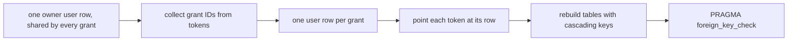

# Moving each app to the package

- **Status:** draft

Each of atc, boxxy, pepys and impz runs one database migration, in its own transaction, when it
starts to use `@zgeoff/mcp-auth`. The migration gives each grant its own row in better-auth's `user`
table, as [grants.md](./grants.md#the-grant-row) describes. The app passes its current table names
to the core, so its passkeys and clients stay in the tables they are in.

## Shape

## Contracts

### atc, boxxy and pepys

Before the migration, these apps keep one owner `user` row, and every grant's tokens point at it.
better-auth stamps each token with `authorizationCodeId`, the ID of the authorization code it came
from, and copies that ID to each new token of a refresh. The migration uses that ID to tell grants
apart. Each app also keeps a table, `<app>_grant_use`, with a `grant_id` and a `last_used_at` per
grant.

A passkey row has no link to a user, so the migration leaves passkeys as they are.

The migration runs these steps in one transaction:

1. Collect each distinct `authorizationCodeId` among the tokens that are neither expired nor
   revoked.
2. Insert one `user` row per ID, with the ID as the row's `id`, and with the columns that
   [grants.md](./grants.md#the-grant-row) lists. Set `approvedBy` to `passkey`. Take `lastUsedAt`
   from the `last_used_at` of the matching `grant_id`, or leave it null when no row matches.
3. Point each token with a collected ID at its new row. Delete every other token.
4. Delete the owner sessions, the owner `user` row and the `<app>_grant_use` table.
5. Rebuild `oauthAccessToken`, `oauthRefreshToken` and `session`, with each `userId` referencing
   `user(id)` on delete cascade.
6. Run `PRAGMA foreign_key_check`. It must return no rows.

### impz

impz keeps one `user` row per grant, and its token and session tables cascade from `user`. Each row
holds `tokenId`, the ID of the imp token that approved the grant, and `imps`, the imp patterns that
the grant covers. When the imp token is `grantable`, the grant may make imp tokens.

The impz migration runs only step 6 of the steps above, after these:

1. Set `approvedBy` to `token:` followed by the row's `tokenId`.
2. Write `limits` as JSON that holds the row's `imps` and the imp token's `grantable` flag.

After the migration, the owner enrolls a passkey with an enrollment token from the impz CLI. The
owner then approves each new grant with that passkey.

## Constraints

- Each app's migration has a test with two grants, one of them refreshed at least once. The test
  runs the migration, and checks that both access tokens pass `verify`. It then revokes one grant,
  and checks that `verify` returns null for that grant's token and passes the other.
- An app on Elysia 1 moves to Elysia 2 before it uses the adapter.

## Builder decides

- Where each app keeps its migration, within the app's own migration runner.
- The order in which the apps move.
