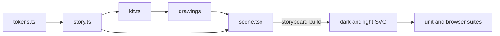

# Storyboard

- **Status:** draft

`@zgeoff/storyboard` is a package that builds the animated SVG images at the top of zgeoff READMEs,
and checks them. A repo writes each image as a scene: a TypeScript story of what happens when, and
JSX drawings that the repo writes for itself. The package works out the time of every beat from the
story, writes a dark and a light SVG file that animate with [SMIL](#words) alone, and gives the repo
two test suites that check those files.

The first scene is the hero of the [atc](https://github.com/zgeoff/atc) README: a 36 s loop in six
stages, in which agents spawn, message each other and wait for a person's approval. atc's committed
`docs/assets/hero-dark.svg` and `docs/assets/hero-light.svg` are the reference for the package's
timing rules, its base colours and how its components look.

## Shape

A scene lives in `scripts/storyboard/<scene>/` in the repo that shows it, and the folder's name is
the scene's name. An arrow from one file to another means that the second file imports the first:
the story imports the scene's colour tokens, the kit gives each drawing components typed by the
story, and `scene.tsx` puts the story and the drawings together. Each drawing is a `.tsx` file of
its own. `storyboard build` turns the scene into its two files, and the repo's suites check them.

The design sits in these docs:

- this one, for the words, the package's entry points and the decisions;
- [authoring.md](./authoring.md), for the files a scene author writes and the timing rules;
- [build-and-check.md](./build-and-check.md), for the build, the output rules and the two suites.

## Words

- **Scene:** one animated image, built from one folder.
- **Stage:** one equal part of a scene's loop, with one caption. A scene with six captions and 6 s
  stages loops every 36 s.
- **Beat:** a named instant in the loop, such as the moment a message lands. The story gives each
  beat as a rule, such as a step of a stage or the reading time of a line after an earlier beat, and
  the package works out its time.
- **Grid:** the 0.5 s steps that every beat lands on.
- **Change:** what happens on a beat. No two beats share an instant, so one change happens at a time
  and a viewer's eye goes to one place.
- **Token:** a named colour, with one value for both files or a value for each.
- **Kit:** the package's components, typed by one scene's story so that a wrong beat or token name
  fails the type check.
- **Ambient loop:** an animation that repeats on its own short period, such as a gentle bob, and
  isn't a change.
- **Hard cut:** a switch from one state to the next in 0.03 s.
- **SMIL:** the animation elements built into SVG, such as `<animate>`. GitHub shows a README image
  through ``, which runs no script and loads nothing else, so SMIL is the only animation that
  plays there.
- **Lane:** a group of tests that [rig](../../../packages/rig/README.md) runs with its own limits.
  rig's browser lane runs `.browser.test.ts` files against Chrome.
- **Flight and pulse:** a flight is a dot that flies along a curve from one agent to another, and a
  pulse is a dot that hops along straight lines. Both land on a beat.

## The package

`@zgeoff/storyboard` is public on npm, and release-please versions it with the other packages. It
has one bin, `storyboard`, and these entry points:

| Entry point         | Holds                                                                                                                                                   |
| ------------------- | ------------------------------------------------------------------------------------------------------------------------------------------------------- |
| `.`                 | `defineTokens`, `defineStory`, `buildSceneKit`, `defineScene`, `buildBowPath` (a curved path between two points), and the `Point` and `StoryNode` types |
| `./jsx-runtime`     | the JSX runtime                                                                                                                                         |
| `./jsx-dev-runtime` | the same runtime, for Bun's development transform                                                                                                       |
| `./checks`          | `describeSceneChecks`, for the unit suite                                                                                                               |
| `./browser`         | `describeFrameChecks`, for the browser suite                                                                                                            |

`@zgeoff/rig` is an optional peer dependency, and only `./browser` imports it.

## Decisions

- **The story holds the whole loop as data.** Beats, terminal lines, status changes and acting
  windows sit in `story.ts`, so a reader learns what happens in each stage from one file.
- **Drawings are JSX on the package's own runtime.** The runtime builds a tree, so the package
  escapes each text once, merges all the animations that target one attribute into one, and gathers
  every `<defs>` entry into one. With strings, each of those would need a parse.
- **Drawings take their components from the scene's kit.** TypeScript can't type a component
  imported from the package by one scene's beat names, so `buildSceneKit` gives back the same
  components typed by that scene's story.
- **The checks are test suites in the repo's own lanes.** rig's browser lane starts and stops
  Chrome, and the shared bun-checks workflow runs that lane in CI, so a repo with a scene needs no
  new workflow or job.

## Builder decides

- Internal module names, and the file layout inside the package.
- How the kit's components get each beat's time when the package renders a scene.
- The wording of each error.
- The visuals inside each component, taken from atc's hero files: a flight's trail, a pulse's tail,
  a status dot's breathing, the caption band's sizes.
- Number formatting in the output, except `keyTimes`, which
  [build-and-check.md](./build-and-check.md#output-rules) fixes.

## Out of scope

- A layout engine. A scene places each part with its own coordinates, and the browser suite catches
  text that overlaps.
- Video or GIF output.
- atc's own drawings of the hero: its islands, tower, cubes and inbox. They stay in atc.
