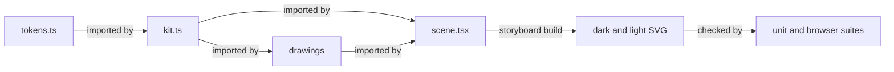

# Storyboard

- **Status:** draft

`@zgeoff/storyboard` is a package that builds the animated SVG images at the top of zgeoff READMEs,
and checks them. A repo writes each image as a [scene](#words): one JSX tree that holds the image's
drawings and its [stages](#words) in order. The package works out when each [change](#words) in a
stage happens, from the order of the changes and the number of words each one puts on screen. It
writes a dark and a light SVG file that animate with [SMIL](#words) alone. It also exports two test
suites, which the repo runs from two short test files of its own.

The first scene is the hero of the [atc](https://github.com/zgeoff/atc) README: a 36 s loop in six
stages, in which agents spawn, message each other and wait for a person's approval. atc's committed
`docs/assets/hero-dark.svg` and `docs/assets/hero-light.svg` are the reference for the package's
timing rules, for how its components look, and for its base colours: the default colours its own
components draw with, which a scene's tokens can add to or replace.

## Shape

A scene lives in `scripts/storyboard/<scene>/` in the repo that shows it, and the folder's name is
the scene's name. The scene author writes every file in the folder:

- `tokens.ts` holds the scene's colours;
- `kit.ts` calls the package's `buildSceneKit` with those colours, and exports the kit;
- each drawing, such as atc's islands, is a `.tsx` file of its own: a function component that draws
  part of the image and takes its components from the kit;
- `scene.tsx` puts the drawings and the stages together.

`storyboard build` turns the scene into its two files, and the repo's suites check them.

The design sits in these docs:

- this one, for the words, the package's entry points and the decisions;
- [authoring.md](./authoring.md), for the files a scene author writes and the timing rules;
- [build-and-check.md](./build-and-check.md), for the build, the output rules and the two suites.

## Words

- **Scene:** one animated image, built from one folder.
- **Stage:** one part of a scene's loop, with one caption. Every stage of a scene lasts the `stageS`
  seconds that the scene sets, so a scene with six stages of 6 s loops every 36 s. The build fails
  when a stage's changes don't fit.
- **Part:** one element from the kit that shows something on the loop, such as a terminal line, a
  status or a flight.
- **Change:** what happens at one instant of the loop, such as a message that lands in a terminal.
  Each direct child of a stage is one change: one part, or a `Beat`, a kit component that holds
  several parts and lands them at one instant. The package places a stage's changes in their order,
  one at a time, so a viewer's eye goes to one place.
- **Grid:** the 0.5 s steps that every change lands on.
- **Reading time:** how long the words of a change stay on screen before the next change: 0.25 s per
  word, plus 0.5 s.
- **Host:** a part that other parts write to, such as a terminal. A function from the kit, such as
  `buildTerminal`, makes a host and returns a handle to it. A part names its host by that handle.
- **Token:** a named colour, with one value for both files or a value for each.
- **Kit:** the set of the package's components that `buildSceneKit` returns for one scene, typed by
  that scene's tokens.
- **Ambient loop:** an animation that repeats on its own short period, such as a gentle bob. It
  belongs to no change.
- **Hard cut:** a switch from one state to the next in 0.03 s, such as a terminal that shrinks at
  the reset. The browser suite renders one frame a hard cut before the loop's end.
- **SMIL:** the animation elements built into SVG, such as `<animate>`. GitHub shows a README image
  through ``, which runs no script and loads nothing else, so SMIL is the only animation that
  plays there.
- **Lane:** a group of tests that [rig](../../../packages/rig/README.md) runs with its own limits.
  rig's browser lane runs `.browser.test.ts` files against Chrome.
- **Flight and pulse:** a flight is a dot that flies along a curve from one agent to another, and a
  pulse is a dot that hops along straight lines. Each one is a part, and its motion ends at the
  instant of its change.

## The package

`@zgeoff/storyboard` is public on npm, and release-please versions it with the other packages. It
has one bin, `storyboard`, and these entry points:

| Entry point         | Holds                                                                                                                                                                 |
| ------------------- | --------------------------------------------------------------------------------------------------------------------------------------------------------------------- |
| `.`                 | `defineTokens`, `buildSceneKit`, `defineScene`, `buildBowPath` (a curved path between two points), `countReadingWords`, and the `Point`, `Host` and `StoryNode` types |
| `./jsx-runtime`     | the JSX runtime                                                                                                                                                       |
| `./jsx-dev-runtime` | the same runtime, for Bun's development transform                                                                                                                     |
| `./checks`          | `describeSceneChecks`, for the unit suite                                                                                                                             |
| `./browser`         | `describeFrameChecks`, for the browser suite                                                                                                                          |

`@zgeoff/rig` is an optional peer dependency, and only `./browser` imports it.

## Decisions

- **Time comes from the tree.** Each stage lists its changes in order, and each part reports the
  words it shows and the motion it needs. A terminal line's own text sets its reading time, so a
  scene author writes each time once, in the tree. When a part has to wait for a change that isn't
  the one just before it, such as a terminal that opens when a flight lands, the scene author gives
  that change an id, and the part names it.
- **Drawings are JSX on the package's own runtime.** The runtime builds a tree, so the package
  escapes each text once, merges all the animations that target one attribute into one, and gathers
  every `<defs>` entry into one. Drawings written as SVG strings would need a parse for each of
  those.
- **Drawings take their components from the scene's kit.** A scene's token names exist only in that
  scene, so TypeScript can type the package's components by them only through `buildSceneKit`, which
  returns the components typed by one scene's tokens.
- **Parts name their host by handle.** A handle's type carries what its host accepts. So a misspelt
  host, or a terminal line sent to a chat panel, fails the type check. A change id stays a string:
  to type it, the scene would have to declare every id before the tree.
- **The checks are test suites in the repo's own lanes.** rig's browser lane starts and stops
  Chrome, and the shared bun-checks workflow runs that lane in CI, so a repo with a scene needs no
  new workflow or job.

## Builder decides

The developer who builds the package decides these:

- Internal module names, and the file layout inside the package.
- The wording of each error.
- The visuals inside each component, taken from atc's hero files: a flight's trail, a pulse's tail,
  a status dot's breathing, the caption band's sizes.
- Number formatting in the output, except `keyTimes`, whose format
  [build-and-check.md](./build-and-check.md#output-rules) sets.

## Out of scope

- A preview player, code that runs on each frame, and video output, all of which a timeline tool
  such as Remotion has. A README image runs no script, so the build fixes every timing before it
  writes the file, and the package's job ends with that file.
- A layout engine. A scene places each part with its own coordinates, and the browser suite catches
  text that overlaps.
- atc's own drawings of the hero: its islands, tower, cubes and inbox. They stay in atc.
