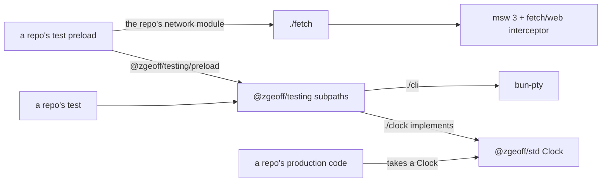

# Shared testing kit

- **Status:** draft
- **Decision records:** [0004](../../decisions/0004-the-clock-interface-lives-in-std.md),
  [0005](../../decisions/0005-fetch-mocking-uses-msw-3.md)

Each zgeoff repo keeps its own copies of the same test helpers: stub binaries on `PATH`, temp
folders, a cleanup registry, `waitFor`, free ports, temp git repos, a fake clock and an MSW setup.
`@zgeoff/testing` grows into one kit that holds the best version of each, behind one subpath per
area, and every repo replaces its copies with the kit. Production code takes its clock from one
`Clock` interface in `@zgeoff/std`, so one fake clock serves every repo.

## Shape



A repo's test preload imports two things. `@zgeoff/testing/preload` restores each changed env var
after every test. The repo's network module is a file of its own that calls `createTestNetwork` with
the repo's MSW handlers, which enables the one MSW network and fails a test on an unhandled request.
Each test imports the helpers it needs from their subpath.

## Subpaths

Each subpath pulls in only its own dependencies. A repo that never mocks fetch never installs msw.

| Subpath     | Holds                                                                                        | Needs                                           | Doc                                    |
| ----------- | -------------------------------------------------------------------------------------------- | ----------------------------------------------- | -------------------------------------- |
| `.`         | `waitFor`, `updateEnv`, `removeEnvOverrides`, `registerTestCleanup`                          | `bun:test`                                      | [process.md](./process.md)             |
| `./preload` | the global hooks, as a side-effect import                                                    | `bun:test`                                      | [process.md](./process.md)             |
| `./process` | `run`, `start`, `claimFreePorts`, `readStreamUntil`                                          | none                                            | [process.md](./process.md)             |
| `./cli`     | `spawnCLI`, with its signature and types unchanged                                           | `bun-pty`                                       | none                                   |
| `./bin`     | stub binaries and their call log                                                             | none                                            | [stub-bins.md](./stub-bins.md)         |
| `./fs`      | temp folders, file trees, the template cache, `readRunFolderPrefix` and `PIDNamespaceSource` | none                                            | [files-and-git.md](./files-and-git.md) |
| `./git`     | `GitEnv`, temp repos, origins, commits                                                       | the `git` binary                                | [files-and-git.md](./files-and-git.md) |
| `./mocks`   | answer queues and stub functions for `mock()`                                                | `bun:test`                                      | [process.md](./process.md)             |
| `./clock`   | the fake clock and its driver                                                                | `@zgeoff/std`                                   | [clock.md](./clock.md)                 |
| `./fetch`   | the test network over MSW                                                                    | `msw` and `@mswjs/interceptors`, optional peers | [fetch.md](./fetch.md)                 |
| `./server`  | stub HTTP servers on the loopback interface                                                  | none                                            | [fetch.md](./fetch.md)                 |

The existing types of `./process` and `./cli` keep their names and subpaths. "Needs" lists
dependencies outside the kit. Every subpath that releases something after the test also imports
`bun:test` through `registerTestCleanup`.

[adoption.md](./adoption.md) holds the order of the PRs, each repo's move to the kit, and the lint
rule that keeps new copies out.

## Cleanup

```ts
// inside a test or a beforeEach: released after the test
const dir = createTempDir('site');

// in a beforeAll: the caller releases it
let server: ProcessHandle;
beforeAll(async () => {
  server = await start(['bun', 'serve.ts'], { cleanup: 'manual' });
});
afterAll(() => server.stop());
```

- Each helper that makes a folder, a process, a port claim or a server registers its release with
  `registerTestCleanup`, and returns a way to release it early.
- Each such helper takes `cleanup?: 'test' | 'manual'` in its options, default `'test'`. With
  `'manual'`, it registers nothing.
- A fixture made in `beforeAll` or at module scope uses `'manual'`. Bun runs an `onTestFinished` or
  `afterAll` hook registered in a `beforeAll` at once, before any test.

## Decisions

- **One subpath per area, and a dependency appears in one subpath only.** `msw` and
  `@mswjs/interceptors` are optional peer dependencies that only `./fetch` imports, and only `./cli`
  imports `bun-pty`. The root export re-exports no subpath.
- **`./helpers` goes away in one breaking release.** Every consumer moves in the same round of PRs,
  so a deprecation period would protect nobody.
- **The kit holds general helpers only.** A stand-in for one product's service, such as
  `@impz/testing`'s fake imp host, stays in that product's package and builds on the kit.
- **The clock interface lives in `@zgeoff/std`.** Production code imports it, and the kit's fake
  implements it. [0004](../../decisions/0004-the-clock-interface-lives-in-std.md)
- **Fetch mocking uses msw 3's `defineNetwork` with the `fetch/web` interceptor.**
  [0005](../../decisions/0005-fetch-mocking-uses-msw-3.md)

## Platforms

- Every subpath runs under Bun 1.4.3 or later, and the package's `engines.bun` says `>=1.4.3`.
- tools' CI runs the kit's tests on Linux only. On macOS, the kit tolerates `EPERM` from a signal to
  an exited process group, and picks ports without a claim.
- `claimFreePorts` claims ports on Linux only, through abstract unix sockets, which macOS lacks. On
  macOS it binds port 0 to pick each port and holds no claim, so a parallel test can race for it.
- `readRunFolderPrefix` names folders by PID namespace on Linux, and by `host` elsewhere.

## Builder decides

- The file layout inside `src/`, and the names of anything a subpath does not export.
- Whether to port a repo's existing helper or write the code fresh. The contracts and constraints
  bind either way.
- The wording of every error message, apart from the `unexpected:` prefix that
  [stub-bins.md](./stub-bins.md) sets.
