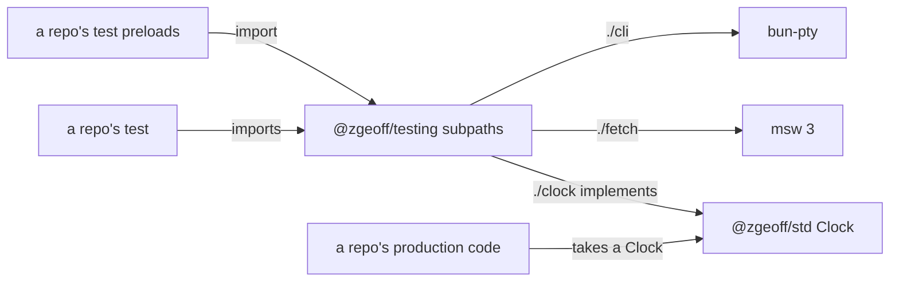

# Shared testing kit

- **Status:** draft
- **Decision records:**
  [0004, the clock interface lives in std](../../decisions/0004-the-clock-interface-lives-in-std.md),
  [0005, fetch mocking uses msw 3](../../decisions/0005-fetch-mocking-uses-msw-3.md)

The zgeoff repos each keep their own copies of the same test helpers: stub commands on `PATH`, temp
folders, a cleanup registry, `waitFor`, free ports, temp git repos, a fake clock and a setup for
msw, the library that mocks `fetch`. The testing kit is `@zgeoff/testing` with one subpath export
per area, and it holds one version of each helper, built from those copies. Every repo deletes its
copies and imports the kit. Production code takes its clock from one `Clock` interface in
`@zgeoff/std`, so one fake clock serves every repo.

`@zgeoff/testing` ships three subpaths before this work: `./cli`, `./process`, and `./helpers`,
which holds every other helper. The kit keeps `./cli` and `./process`, adds the root export, and
splits `./helpers` into the other subpaths in the table below.

## Shape



Every repo's `bunfig.toml` lists `@zgeoff/testing/preload` as a test preload, which restores the env
vars that `updateEnv` changed after each test. A repo that mocks fetch lists a second preload: its
network module, a file such as `test-utils/network.ts` that calls `createTestNetwork` with the
repo's msw handlers. That call sets up the single msw network of the test process, which fails a
test that sends a request no handler matches. Each test imports the helpers it needs from their
subpath.

## Subpaths

The "Needs" column lists what a subpath imports from outside Bun and the kit. `msw` and
`@mswjs/interceptors` are optional peer dependencies, so a repo that never mocks fetch never
installs them. `bun-pty` is a regular dependency, and only `./cli` loads it.

| Subpath     | Holds                                                                                                     | Needs                                           | Doc                                    |
| ----------- | --------------------------------------------------------------------------------------------------------- | ----------------------------------------------- | -------------------------------------- |
| `.`         | `waitFor`, `updateEnv`, `removeEnvOverrides`, `registerTestCleanup`                                       | none                                            | [process.md](./process.md)             |
| `./preload` | the env-restore hook, as a side-effect import                                                             | none                                            | [process.md](./process.md)             |
| `./process` | `run`, `start`, `claimFreePorts`, `readStreamUntil`                                                       | none                                            | [process.md](./process.md)             |
| `./cli`     | `spawnCLI`, which runs a program in a pseudo-terminal; no change                                          | `bun-pty`                                       | none                                   |
| `./bin`     | stub commands and their call log                                                                          | none                                            | [stub-bins.md](./stub-bins.md)         |
| `./fs`      | temp folders, file trees, a cache of template folders that are slow to build, the temp-folder name prefix | none                                            | [files-and-git.md](./files-and-git.md) |
| `./git`     | the env for test git calls, temp repos, bare origins, commits                                             | the `git` binary                                | [files-and-git.md](./files-and-git.md) |
| `./mocks`   | stub functions to pass to `mock()`                                                                        | none                                            | [process.md](./process.md)             |
| `./clock`   | the fake clock, and `runClockUntil`, which moves it forward until a condition holds                       | `@zgeoff/std`                                   | [clock.md](./clock.md)                 |
| `./fetch`   | the test network over msw                                                                                 | `msw` and `@mswjs/interceptors`, optional peers | [fetch.md](./fetch.md)                 |
| `./server`  | stub HTTP servers on the loopback interface                                                               | none                                            | [fetch.md](./fetch.md)                 |

[adoption.md](./adoption.md) holds the order of the PRs, each repo's move onto the kit, and the lint
rule that fails a new local copy.

## Cleanup

```ts
// inside a test or a beforeEach: released after the test
const dir = createTempDir('site');

// in a beforeAll: the caller releases it
let server: ProcessHandle;
beforeAll(async () => {
  server = await start(['bun', 'serve.ts'], { cleanup: 'manual' });
});
afterAll(() => server.stop());
```

- Each helper that makes a folder, a process, a port claim or a server releases it after the test
  through `registerTestCleanup`, and returns a way to release it early.
- Each such helper takes `cleanup?: 'test' | 'manual'` in its options, default `'test'`. With
  `'manual'`, the helper skips `registerTestCleanup`, and the caller releases what it made.
- `registerTestCleanup` releases through Bun's `onTestFinished` hook. When a `beforeAll` registers
  that hook, Bun runs it as soon as the `beforeAll` ends, so a fixture made in a `beforeAll` or at
  module scope passes `'manual'`. Otherwise the fixture is gone before the first test.
- `spawnCLI` returns an `AsyncDisposable` handle that the test disposes with `await using`, and it
  never calls `registerTestCleanup`.

## Decisions

- **One subpath per area, and each outside dependency in one subpath only.** The root export never
  re-exports a subpath, so importing the root never loads `msw` or `bun-pty`.
- **`./helpers` goes away in one breaking release.** Every consumer moves in the same round of PRs,
  so a deprecation period would protect no one.
- **The kit holds general helpers only.** A stand-in for one product's service, such as
  `@impz/testing`'s fake imp host, stays in that product's package and builds on the kit.
- **The clock interface lives in `@zgeoff/std`.**
  [0004](../../decisions/0004-the-clock-interface-lives-in-std.md)
- **Fetch mocking uses msw 3's `defineNetwork` with the `fetch/web` interceptor.**
  [0005](../../decisions/0005-fetch-mocking-uses-msw-3.md)

## Platforms

Every subpath runs under Bun 1.4.3 or later, and the package's `engines.bun` says `>=1.4.3`. The
tools repo's CI runs the kit's tests on Linux only. On macOS, the kit behaves differently in these
ways:

- A signal to a process group whose leader has exited fails with `EPERM`, and the kit treats the
  group as gone, as [process.md](./process.md) says.
- `claimFreePorts` picks a port that the OS reports free and holds nothing, so a parallel test can
  race for it. On Linux, it holds each port until the test ends.
- `readRunFolderPrefix` builds each temp folder's name from the process ID and the PID namespace, so
  a sweep can tell a dead run's folder from a live one. macOS has no PID namespaces, so the name
  holds the word `host` in its place.

## Builder decides

- The file layout inside `src/`, and the names of anything a subpath does not export.
- Whether to port a repo's helper or write the code fresh. The contracts and constraints bind either
  way.
- The semver bump in the release commit.
- The wording of every error message, apart from the `unexpected:` prefix in
  [stub-bins.md](./stub-bins.md).
