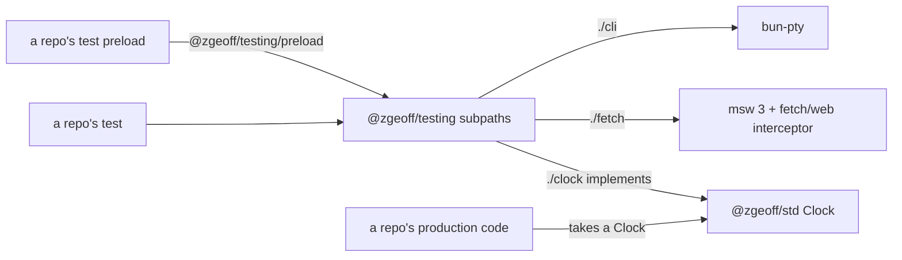

# Shared testing kit

- **Status:** draft
- **Decision records:** [0004](../../decisions/0004-the-clock-interface-lives-in-std.md),
  [0005](../../decisions/0005-fetch-mocking-uses-msw-3.md)

Each zgeoff repo keeps its own copies of the same test helpers: stub binaries on `PATH`, temp
folders, a cleanup registry, `waitFor`, free ports, temp git repos, a fake clock and an MSW setup.
`@zgeoff/testing` grows into one kit that holds the best version of each, behind one subpath per
area, and every repo replaces its copies with the kit. Production code takes its clock from one
`Clock` interface in `@zgeoff/std`, so one fake clock serves every repo.

## Shape

A repo's test preload imports `@zgeoff/testing/preload`, which restores each changed env var after
every test, and the repo's own network module, which enables the one MSW network and fails a test on
an unhandled request. Each test imports the helpers it needs from their subpath.

## Subpaths

Each subpath pulls in only its own dependencies. A repo that never mocks fetch never installs msw.

| Subpath     | Holds                                                     | Needs                                           | Doc                                    |
| ----------- | --------------------------------------------------------- | ----------------------------------------------- | -------------------------------------- |
| `.`         | `waitFor`, `updateEnv`, `registerTestCleanup`             | `bun:test`                                      | [process.md](./process.md)             |
| `./preload` | the global hooks, as a side-effect import                 | `bun:test`                                      | [process.md](./process.md)             |
| `./process` | `run`, `start`, `claimFreePorts`                          | none                                            | [process.md](./process.md)             |
| `./cli`     | `spawnCLI`                                                | `bun-pty`                                       | unchanged                              |
| `./bin`     | stub binaries and their call log                          | none                                            | [stub-bins.md](./stub-bins.md)         |
| `./fs`      | temp folders, file trees, the cross-worker template cache | none                                            | [files-and-git.md](./files-and-git.md) |
| `./git`     | git env, temp repos, origins, commits                     | the `git` binary                                | [files-and-git.md](./files-and-git.md) |
| `./mocks`   | answer queues and stub functions for `mock()`             | `bun:test`                                      | [process.md](./process.md)             |
| `./clock`   | the fake clock and its driver                             | `@zgeoff/std`                                   | [clock.md](./clock.md)                 |
| `./fetch`   | the test network over MSW, and stub HTTP servers          | `msw` and `@mswjs/interceptors`, optional peers | [fetch.md](./fetch.md)                 |

[adoption.md](./adoption.md) holds the order of the PRs, each repo's move to the kit, and the lint
rule that keeps new copies out.

## Decisions

- **One subpath per area, and a dependency appears in one subpath only.** `msw` and
  `@mswjs/interceptors` are optional peer dependencies that only `./fetch` imports, and only `./cli`
  imports `bun-pty`.
- **`./helpers` goes away.** Its exports move to the subpaths above in one breaking release, and
  every consumer moves in the same round of PRs.
- **The kit holds general helpers only.** A stand-in for one product's service, such as
  `@impz/testing`'s fake imp host, stays in that product's package and builds on the kit.
- **Every helper with cleanup registers it.** A helper that makes a folder, a process, a claim or a
  server releases it after the test through `registerTestCleanup`, and also returns a way to release
  it early.
- **The clock interface lives in `@zgeoff/std`.** Production code imports it, and the kit's fake
  implements it. [0004](../../decisions/0004-the-clock-interface-lives-in-std.md)
- **Fetch mocking uses msw 3's `defineNetwork` with the `fetch/web` interceptor.**
  [0005](../../decisions/0005-fetch-mocking-uses-msw-3.md)

## Platforms

- Every subpath runs on Linux and macOS under Bun 1.4.3 or later.
- `claimFreePorts` claims ports on Linux only. On macOS it binds port 0 to pick each port and holds
  no claim, so a parallel test can race for it.
- `readRunFolderPrefix` names folders by PID namespace on Linux, and by `host` elsewhere.

## Builder decides

- The file layout inside `src/`, and the names of anything a subpath does not export.
- Whether `.` re-exports any subpath.
- The wording of every error message, apart from the `unexpected:` prefix that
  [stub-bins.md](./stub-bins.md) sets.
