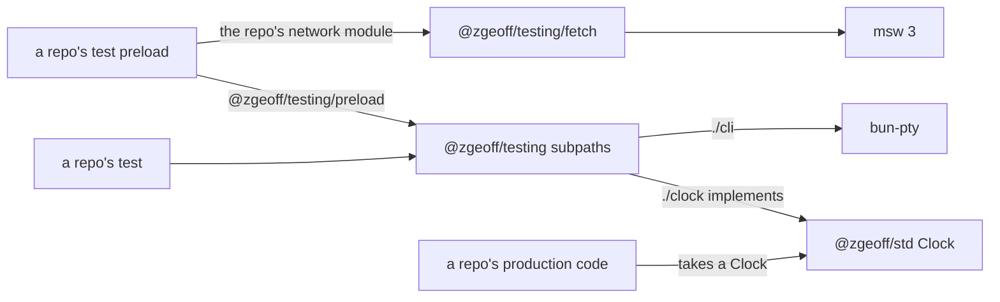

# Shared testing kit

- **Status:** draft
- **Decision records:**
  [0004, the clock interface lives in std](../../decisions/0004-the-clock-interface-lives-in-std.md),
  [0005, fetch mocking uses msw 3](../../decisions/0005-fetch-mocking-uses-msw-3.md)

The zgeoff repos each keep their own copies of the same test helpers: stub commands on `PATH`, temp
folders, a cleanup registry, `waitFor`, free ports, temp git repos, a fake clock and a setup for
msw, the library that mocks `fetch`. The testing kit is `@zgeoff/testing` with one subpath export
per area, and it holds one version of each helper, built from those copies. Every repo deletes its
copies and imports the kit. Production code takes its clock from one `Clock` interface in
`@zgeoff/std`, so one fake clock serves every repo.

Today `@zgeoff/testing` has three subpaths: `./cli`, `./process`, and `./helpers`, which holds every
other helper. The kit keeps `./cli` and `./process`, and splits `./helpers` into the subpaths below.

## Shape



A repo's `bunfig.toml` lists two test preloads. `@zgeoff/testing/preload` restores each env var that
a test changed. The repo's network module, a file such as `test-utils/network.ts`, calls
`createTestNetwork` with the repo's msw handlers. That call creates the process's one msw network,
and makes a test fail when it sends a request that no handler matches. Each test imports the helpers
it needs from their subpath.

## Subpaths

"Needs" lists what a subpath imports from outside Bun and the kit. Each subpath imports only its
own, so a repo that never mocks fetch never installs msw.

| Subpath     | Holds                                                                                           | Needs                                           | Doc                                    |
| ----------- | ----------------------------------------------------------------------------------------------- | ----------------------------------------------- | -------------------------------------- |
| `.`         | `waitFor`, `updateEnv`, `removeEnvOverrides`, `registerTestCleanup`                             | none                                            | [process.md](./process.md)             |
| `./preload` | the env-restore hook, as a side-effect import                                                   | none                                            | [process.md](./process.md)             |
| `./process` | `run`, `start`, `claimFreePorts`, `readStreamUntil`                                             | none                                            | [process.md](./process.md)             |
| `./cli`     | `spawnCLI`, which runs a program in a pseudo-terminal, with its signature and types as they are | `bun-pty`                                       | none                                   |
| `./bin`     | stub commands and their call log                                                                | none                                            | [stub-bins.md](./stub-bins.md)         |
| `./fs`      | temp folders, file trees, the cache of built template folders, `readRunFolderPrefix`            | none                                            | [files-and-git.md](./files-and-git.md) |
| `./git`     | the git env, temp repos, bare origins, commits                                                  | the `git` binary                                | [files-and-git.md](./files-and-git.md) |
| `./mocks`   | stub functions to pass to `mock()`                                                              | none                                            | [process.md](./process.md)             |
| `./clock`   | the fake clock and its driver                                                                   | `@zgeoff/std`                                   | [clock.md](./clock.md)                 |
| `./fetch`   | the test network over msw                                                                       | `msw` and `@mswjs/interceptors`, optional peers | [fetch.md](./fetch.md)                 |
| `./server`  | stub HTTP servers on the loopback interface                                                     | none                                            | [fetch.md](./fetch.md)                 |

[adoption.md](./adoption.md) holds the order of the PRs, each repo's move onto the kit, and the lint
rule that fails a new local copy.

## Cleanup

```ts
// inside a test or a beforeEach: released after the test
const dir = createTempDir('site');

// in a beforeAll: the caller releases it
let server: ProcessHandle;
beforeAll(async () => {
  server = await start(['bun', 'serve.ts'], { cleanup: 'manual' });
});
afterAll(() => server.stop());
```

- Each helper that makes a folder, a process, a port claim or a server registers its release with
  `registerTestCleanup`, and returns a way to release it early. `spawnCLI` keeps its own disposal,
  as it has today.
- Each such helper takes `cleanup?: 'test' | 'manual'` in its options, default `'test'`. With
  `'manual'`, the helper skips the registration, and the caller releases what it made.
- A fixture made in a `beforeAll` or at module scope passes `'manual'`. Bun runs an `onTestFinished`
  or `afterAll` hook that a `beforeAll` registers right after that `beforeAll` ends, so the fixture
  would be gone before the first test.

## Decisions

- **One subpath per area, and each outside dependency in one subpath only.** `msw` and
  `@mswjs/interceptors` are optional peer dependencies that only `./fetch` imports, and only `./cli`
  imports `bun-pty`. The root export never re-exports a subpath.
- **`./helpers` goes away in one breaking release.** Every consumer moves in the same round of PRs,
  so a deprecation period would protect no one.
- **The kit holds general helpers only.** A stand-in for one product's service, such as
  `@impz/testing`'s fake imp host, stays in that product's package and builds on the kit.
- **The clock interface lives in `@zgeoff/std`.** Production code imports it, and the kit's fake
  implements it. [0004](../../decisions/0004-the-clock-interface-lives-in-std.md)
- **Fetch mocking uses msw 3's `defineNetwork` with the `fetch/web` interceptor.**
  [0005](../../decisions/0005-fetch-mocking-uses-msw-3.md)

## Platforms

- Every subpath runs under Bun 1.4.3 or later, and the package's `engines.bun` says `>=1.4.3`.
- The tools repo's CI runs the kit's tests on Linux only. The kit also runs on macOS, where two
  things differ: [process.md](./process.md) covers the `EPERM` from a signal to an exited process
  group, and port picks that hold no claim.
- On Linux, `readRunFolderPrefix` puts the PID namespace in each folder name. Elsewhere it puts the
  word `host` there.

## Builder decides

- The file layout inside `src/`, and the names of anything a subpath does not export.
- Whether to port a repo's helper or write the code fresh. The contracts and constraints bind either
  way.
- The semver bump in the release commit.
- The wording of every error message, apart from the `unexpected:` prefix that
  [stub-bins.md](./stub-bins.md) sets.
