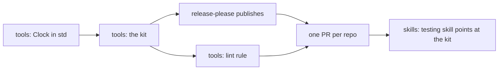

# Adoption

- **Status:** draft

Every zgeoff repo replaces its own copies of the kit's helpers with imports from `@zgeoff/testing`,
takes its clock from `@zgeoff/std`, and runs its fetch mocking on msw 3 through `./fetch`. A lint
rule in `@zgeoff/oxlint-config` then fails a new local copy.

## Shape



## Order

Other repos install `@zgeoff/std` and `@zgeoff/testing` from npm, so every repo PR waits on the
release that publishes the kit.

1. **tools: the clock.** Add `Clock` and `systemClock` to `@zgeoff/std`. Give `std`'s tests their
   own copies of `readRunFolderPrefix` and `readStreamUntil`, and remove `std`'s dependency on
   `@zgeoff/testing`.
2. **tools: the kit,** after step 1 merges. Build the subpaths, remove `./helpers`, and move tools
   itself onto the kit in the same PR:
   - every tools package that imports `./helpers` moves to the new subpaths, and replaces its own
     copies of kit helpers, such as chex's stub commands and agent-hooks' per-run template;
   - the catalog moves `msw` to 3, the root preload's `setupServer` moves to `createTestNetwork`,
     and the root `bunfig.toml` adds `@zgeoff/testing/preload`;
   - `rig` moves to `Clock`, and its stepping and signalling clock fakes give way to
     `createFakeClock`;
   - `mcp-auth` keeps exporting its `Clock` type, as `Pick<Clock, 'now'>` of std's, so its public
     API doesn't break.
3. **tools: the lint rule,** in `@zgeoff/oxlint-config`.
4. **The release** of `std`, `testing` and `oxlint-config`, through release-please.
5. **One PR per repo,** in any order, each after the release. Each PR bumps the three packages, adds
   `@zgeoff/testing/preload` to the test preload, moves the repo to `Clock` and msw 3, and replaces
   its local copies.
6. **zgeoff/skills: the testing skill.** It points at the kit's subpaths in place of hand-written
   helpers, and its HTTP reference shows `createTestNetwork`.

## Each repo

The table lists the copies the audit found. Before it replaces them, each repo PR searches its test
files and `test-utils/` folders for every name the kit exports.

| Repo      | Clock today                           | msw today | Local copies the kit replaces                                                                                                    |
| --------- | ------------------------------------- | --------- | -------------------------------------------------------------------------------------------------------------------------------- |
| atc       | `now`, `schedule`                     | none      | `createStubBin`, `setupTempDir`, `registerTestCleanup`, `waitFor`, `runCommand`, `takeFreePort`                                  |
| boxxy     | `now`, `schedule`                     | 3         | `setupTempDir`, `registerTestCleanup`, `writeTreeFiles`, `waitFor`, the MSW setup                                                |
| osrs      | `now`, `schedule`                     | 2.15      | `createManualClock`, `runClockUntil`                                                                                             |
| impz      | `now`, `startTimer`, `sleep`          | 2.15      | `createStubBin`, `createStubAnsweringBin`, `createCommandLinks`, `claimFreePorts`, `buildRoutedFetch`, `waitFor`, the fake clock |
| nixie     | `now`, `sleep` that resolves on abort | 2.15      | `createStubProgram`, `buildTestClock`, `createRunTemplate`, the MSW setup                                                        |
| stu       | `now`, `sleep` that rejects on abort  | none      | the fake clock, the stub servers                                                                                                 |
| vers      | none                                  | 2.15      | `createStubCommand`, `waitFor`, the MSW setup                                                                                    |
| llm       | none                                  | 2.15      | the MSW setup                                                                                                                    |
| auto-mode | none                                  | 2.15      | the MSW setup                                                                                                                    |
| cloud     | none                                  | 3         | `createGitOrigin`, the unhandled-request check                                                                                   |
| pepys     | none                                  | 3         | `readFreePort`, the MSW setup                                                                                                    |
| wringer   | none                                  | 3         | `createStubGH`, `removeTestFolder`, `createTestFolder`, the MSW setup                                                            |
| noslop    | none                                  | 3         | `createTestRepo`, `createStubCLI`                                                                                                |

## Constraints

- A repo PR changes no test's assertions. When a test fails on the kit's helper, the PR fixes the
  helper's use or the code under test, and names the fix in its description.
- impz's two `StartTimer` types take their arguments in opposite orders. Each call site moves to
  `schedule(fire, delayMs)` by hand.
- In stu, each caller of an aborted `sleep` that relied on the rejection checks `signal.aborted`
  after the sleep.
- A stand-in tied to one product's service stays in that repo or package, and builds on the kit's
  helpers. impz's fake imp host stays in `@impz/testing`.
- cloud's bats stand-ins for its shell scripts stay in bash. The kit replaces only its TypeScript
  helpers.

## The lint rule

```ts
// @zgeoff/oxlint-config, rule zgeoff/use-testing-kit
// fails: a function declared under test-utils/ or in a *.test.ts file whose name a kit subpath exports
export function waitFor() {}
// error: waitFor is exported by @zgeoff/testing; import it from there
```

- The rule reads the kit's export names from `@zgeoff/testing` at lint time, so a new kit export
  needs no rule change.
- The rule skips a one-word name, such as `run` or `start`, which a repo may use for something else.
- The rule also fails an import of `setupServer` from `msw/node`, and an import of
  `@mswjs/interceptors/fetch`, naming `createTestNetwork` as the fix.

## Builder decides

- How each repo PR splits its work into commits.
- Whether a repo keeps a thin local wrapper around a kit helper, for a repo-specific default such as
  a stub folder name.
