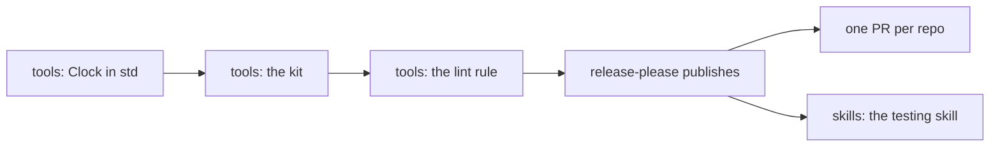

# Adoption

- **Status:** draft

Every zgeoff repo moves onto the [testing kit](./README.md), `@zgeoff/testing`: it deletes its own
copies of the kit's helpers and imports the kit's. Its production code takes the `Clock` interface
from `@zgeoff/std`, as [clock.md](./clock.md) describes, and its tests mock fetch through
`@zgeoff/testing/fetch` on msw 3, as [fetch.md](./fetch.md) describes. A lint rule in
`@zgeoff/oxlint-config` then fails each new local copy.

## Shape

Each arrow points from a step to a step that waits for it. The prefix names the repo of each PR:
`tools` is zgeoff/tools, and `skills` is zgeoff/skills.



## Order

Other repos install `@zgeoff/std` and `@zgeoff/testing` from npm, so every repo PR waits for the
release that publishes the kit.

1. **tools: the clock.** Add `Clock` and `systemClock` to `@zgeoff/std`. The kit will depend on
   `@zgeoff/std` for `Clock`, so `@zgeoff/std` drops its own dependency on `@zgeoff/testing`, and
   the tools repo's `check:release-workflow` never sees a cycle. `@zgeoff/std`'s tests get their own
   copies of the two helpers they import from the kit, `readRunFolderPrefix` and `readStreamUntil`.
2. **tools: the kit,** after step 1 merges. Build each subpath that the README's
   [Subpaths](./README.md#subpaths) table lists, and remove `./helpers`, the subpath that holds
   today's helpers. In the same PR, move the tools repo itself onto the kit:
   - each tools package that imports `./helpers` imports the new subpaths, and deletes its own
     copies of kit helpers, such as chex's stub commands and agent-hooks' per-run template;
   - the catalog pins `msw` 3.0.4 and `@mswjs/interceptors` 0.45.11, the root preload's
     `setupServer` is replaced by a network module, a file of the tools repo that calls
     `createTestNetwork` and that the root `bunfig.toml` lists as a preload, and the root
     `bunfig.toml` lists `@zgeoff/testing/preload`; - each call of `start`, from
     `@zgeoff/testing/process`, inside a `beforeAll` passes `cleanup: 'manual'`, and its `afterAll`
     calls `stop`. With the default, the process would stop before the first test, as the README's
     [Cleanup](./README.md#cleanup) section explains;
   - `rig`'s clock types take `Pick<Clock, 'now' | 'sleep'>`, and its stepping clock fake is
     replaced by `createFakeClock`. A rig test that needs a clock that moves on each read keeps a
     small local fake of that `Pick`;
   - `mcp-auth` exports its `Clock` type as `Pick<Clock, 'now'>`, with `Clock` from `@zgeoff/std`,
     so its public API stays the same.
3. **tools: the lint rule,** in `@zgeoff/oxlint-config`, as [The lint rule](#the-lint-rule)
   describes.
4. **The release** of `@zgeoff/std`, `@zgeoff/testing` and `@zgeoff/oxlint-config`, through
   release-please.
5. **One PR per repo,** in any order, each after the release. Each PR bumps the three packages,
   lists `@zgeoff/testing/preload` in its test preload, moves the repo's clock to `Clock` and its
   fetch mocking to msw 3, and replaces its local copies, which [Each repo](#each-repo) lists.
6. **skills: the testing skill,** after the release. Its rules point at the kit's subpaths in place
   of hand-written helpers, and its HTTP reference shows `createTestNetwork`.

## Each repo

The table lists the copies that a search of each repo found when this design was written. Each repo
PR first searches the repo's test files and `test-utils/` folders for every name the kit exports,
and replaces what it finds too. "Clock" lists the methods of the clock object that the repo's
production code passes around, and "none" means the repo has none. "msw" gives the major version the
repo installs. In the last column, each description names the kit export that replaces it.

| Repo      | Clock                                 | msw  | Local copies the kit replaces                                                                                                                        |
| --------- | ------------------------------------- | ---- | ---------------------------------------------------------------------------------------------------------------------------------------------------- |
| atc       | `now`, `schedule`                     | none | `createStubBin`, `setupTempDir`, `registerTestCleanup`, `waitFor`, `runCommand`, `takeFreePort`                                                      |
| boxxy     | `now`, `schedule`                     | 3    | `setupTempDir`, `registerTestCleanup`, `writeTreeFiles`, `waitFor`, the msw setup (`createTestNetwork`)                                              |
| osrs      | `now`, `schedule`                     | 2.15 | `createManualClock`, `runClockUntil`                                                                                                                 |
| impz      | `now`, `startTimer`, `sleep`          | 2.15 | `createStubBin`, `createStubAnsweringBin`, `createCommandLinks`, `claimFreePorts`, `buildRoutedFetch`, `waitFor`, the fake clock (`createFakeClock`) |
| nixie     | `now`, `sleep` that resolves on abort | 2.15 | `createStubProgram`, `buildTestClock`, `createRunTemplate`, the msw setup (`createTestNetwork`)                                                      |
| stu       | `now`, `sleep` that rejects on abort  | none | the fake clock (`createFakeClock`), the stub servers (`startStubServer`)                                                                             |
| vers      | none                                  | 2.15 | `createStubCommand`, `waitFor`, the msw setup (`createTestNetwork`)                                                                                  |
| llm       | none                                  | 2.15 | the msw setup (`createTestNetwork`)                                                                                                                  |
| auto-mode | none                                  | 2.15 | the msw setup (`createTestNetwork`)                                                                                                                  |
| cloud     | none                                  | 3    | `createGitOrigin`, the unhandled-request check (`createTestNetwork`)                                                                                 |
| pepys     | none                                  | 3    | `readFreePort`, the msw setup (`createTestNetwork`)                                                                                                  |
| wringer   | none                                  | 3    | `createStubGH`, `removeTestFolder`, `createTestFolder`, the msw setup (`createTestNetwork`)                                                          |
| noslop    | none                                  | 3    | `createTestRepo`, `createStubCLI`                                                                                                                    |

## Constraints

- A move onto the kit, in tools or in a repo, keeps every assertion about the code under test. A
  test that asserts a replaced helper's own output, such as a call log's line format, moves to the
  kit's form of that output.
- A test that starts failing because the kit now fails an unmatched request gets a handler in the
  same PR.
- impz has two `StartTimer` types. Its daemon's and client's type takes `(fire, durationMs)`, the
  order of `Clock.schedule`. Its CLI's type takes `(durationMs, fire)`, so each call site of the
  CLI's type swaps its arguments by hand.
- `Clock.sleep` resolves on abort. In stu, `sleep` rejects on abort today, so each stu caller that
  relied on the rejection checks `signal.aborted` after the sleep.
- A stand-in tied to one product's service stays in that repo or package, and builds on the kit's
  helpers. impz's fake imp host stays in `@impz/testing`.
- cloud's bats stand-ins for its shell scripts stay in bash. The kit replaces only its TypeScript
  helpers.

## The lint rule

```ts
// @zgeoff/oxlint-config, rule zgeoff/use-testing-kit
// Fails a function declared under test-utils/ or in a *.test.ts file when a kit subpath exports a function of the same name.
export function waitFor() {}
// error: waitFor is exported by @zgeoff/testing; import it from there
```

- The rule reads the kit's export names from the installed `@zgeoff/testing` when it lints, so a new
  kit export needs no change to the rule.
- The rule skips a name with no capital letter, such as `run` or `start`, which a repo may use for
  something else. It checks `waitFor` and every other camelCase name.
- The rule also fails an import of `setupServer` from `msw/node`, and an import of
  `@mswjs/interceptors/fetch`. Its error message tells the author to use `createTestNetwork`.

## Builder decides

The builder is whoever writes each PR in [Order](#order).

- How each PR splits its work into commits.
- Whether a repo keeps a thin local wrapper around a kit helper, for a default of its own such as a
  stub folder name.
