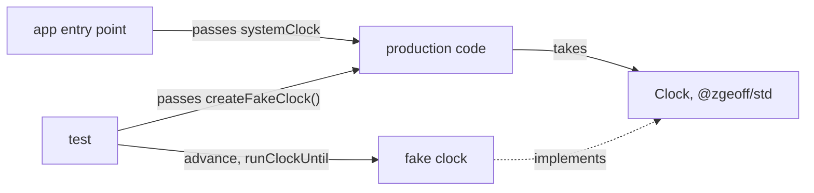

# Clock

- **Status:** draft
- **Decision records:**
  [0004, the clock interface lives in std](../../decisions/0004-the-clock-interface-lives-in-std.md)

Production code reads time and waits through one `Clock` interface from `@zgeoff/std`, passed in as
an argument. A test passes in the fake clock from `@zgeoff/testing/clock`, a subpath of the
[testing kit](./README.md), and moves time forward by hand.

## Shape



## Contracts

### The interface

```ts
// @zgeoff/std
export interface Clock {
  now(): number; // epoch milliseconds
  schedule(fire: () => void, delayMs: number): () => void; // returns cancel
  sleep(delayMs: number, signal?: AbortSignal): Promise<void>; // resolves early on abort, and never rejects
}

export const systemClock: Clock;
```

```ts
// a consumer takes only the methods it calls
function createTokenCache(clock: Pick<Clock, 'now'>) {}
function createRetrier(clock: Pick<Clock, 'now' | 'sleep'>) {}
```

```ts
// a caller of sleep checks the signal itself
await clock.sleep(backoffMs, signal);
if (signal.aborted) {
  return;
}
```

### The fake

```ts
const clock = createFakeClock({ startMs: Date.UTC(2026, 0, 1) });

const cancel = clock.schedule(onTimeout, 500);
clock.advance(499); // nothing fires
clock.advance(1); // onTimeout fires
clock.readNextDueMs(); // → null

const nap = clock.sleep(1000);
clock.countPending(); // → 1
clock.advance(1000); // nap resolves
clock.delays; // → [500, 1000], every delay as the caller passed it, before a negative one becomes 0
```

```ts
await runClockUntil(clock, () => job.state === 'done', { maxMs: 60_000 });
// steps the clock to each next due time, with one setImmediate turn between steps
// or throws: Error('the condition stayed false for 60000 ms of clock time')
```

```ts
// @zgeoff/testing/clock
interface FakeClock extends Clock {
  advance(durationMs: number): void;
  readNextDueMs(): number | null; // the earliest due time of a timer or a sleep
  countPending(): number; // timers and sleeps not yet fired, cancelled or aborted
  readonly delays: readonly number[];
}

function createFakeClock(options?: { readonly startMs?: number }): FakeClock; // default startMs 0
function runClockUntil(
  clock: FakeClock,
  isMet: () => boolean,
  options: { readonly maxMs: number; readonly idleMs?: number }, // idleMs: real milliseconds, default 2000
): Promise<void>;
```

## Constraints

- `schedule` and `sleep` treat a negative delay as 0.
- `cancel` is idempotent, and a cancel after the timer fired does nothing.
- An aborted `sleep` resolves at once and removes its abort listener. A `sleep` given a signal that
  is already aborted resolves without waiting. Every rule in this list binds `systemClock` and the
  fake alike, apart from the rules that name `advance` or `runClockUntil`.
- `advance(durationMs)` moves the clock to a target time, `now()` plus `durationMs`. On the way, it
  fires each timer and resolves each sleep that is due at or before the target, in due order, and
  sets `now()` to each one's due time before it fires that one.
- Two timers due at the same time fire in the order they were scheduled.
- When a firing timer schedules a new timer that is due at or before the target, the same `advance`
  fires the new timer too.
- `advance` never fires a timer that an earlier timer in the same `advance` cancelled.
- `runClockUntil` checks `isMet` first, and returns at once when it is already true. Otherwise each
  step moves the clock to the next due time, waits for one `setImmediate` turn so that the code
  woken by the step can run, and checks `isMet` again.
- When nothing is pending, a step waits for a real 1 ms timer, not one `setImmediate` turn, without
  moving the clock, and checks `isMet` again. The steps go on while real file, process or socket
  work that the code under test does between two sleeps runs, until it schedules the next sleep.
- `runClockUntil` throws `Error('nothing is scheduled and the condition is still false')` only after
  `idleMs` of real time passes with nothing pending in a row, 2000 ms by default. A step that finds
  something pending resets that count, and the limit stops a test that waits on nothing from
  hanging.
- `runClockUntil` stops at `maxMs` past the time it started. When the next due time falls past that
  limit, it moves the clock to the limit, waits one `setImmediate` turn, and checks `isMet` once
  more. It resolves when that check is true, and throws otherwise.
- `@zgeoff/std` never depends on `@zgeoff/testing` in any dependency field. The fake clock makes
  `@zgeoff/testing` depend on `@zgeoff/std`, so a dependency back would make a cycle, and the tools
  repo's `check:release-workflow` fails on a cycle.

## Decisions

- **A consumer takes a `Pick` of `Clock`.** A component that only reads time takes
  `Pick<Clock, 'now'>`, so its tests pass `{ now: () => fixedMs }` with no fake.
- **`sleep` resolves on abort.** The caller aborts its own signal on purpose, so an abort is no
  error. The caller checks `signal.aborted` after the sleep and has nothing to catch.
- **`schedule(fire, delayMs)` takes the callback first,** as `setTimeout` does.

## Builder decides

- How `systemClock.schedule` cancels: `clearTimeout`, or a flag that the code after an awaited
  `Bun.sleep` checks.
- The fake clock's internal timer queue.

## Out of scope

- Temporal values. `Clock.now()` returns epoch milliseconds, and no `Clock` method returns a
  Temporal value. A function that takes a `Temporal.Instant` argument keeps it.
- Faking `Date` or the global timers. The fake replaces only what code receives as a `Clock`.
