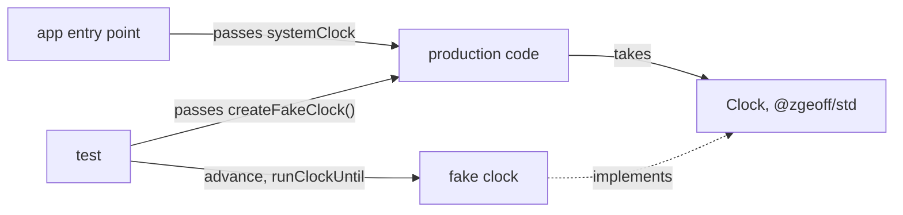

# Clock

- **Status:** draft
- **Decision records:** [0004](../../decisions/0004-the-clock-interface-lives-in-std.md)

Production code reads time and waits through one `Clock` interface from `@zgeoff/std`, passed in as
an argument. A test passes the fake clock from `@zgeoff/testing/clock` in its place, and moves time
forward by hand.

## Shape



## Contracts

### The interface

```ts
// @zgeoff/std
export interface Clock {
  now(): number; // epoch milliseconds
  schedule(fire: () => void, delayMs: number): () => void; // returns cancel
  sleep(delayMs: number, signal?: AbortSignal): Promise<void>; // resolves early on abort, and never rejects
}

export const systemClock: Clock;
```

```ts
// a consumer takes only the methods it calls
function createTokenCache(clock: Pick<Clock, 'now'>) {}
function createRetrier(clock: Pick<Clock, 'now' | 'sleep'>) {}
```

```ts
// a caller of sleep checks the signal itself
await clock.sleep(backoffMs, signal);
if (signal.aborted) {
  return;
}
```

### The fake

```ts
const clock = createFakeClock({ startMs: Date.UTC(2026, 0, 1) });

const cancel = clock.schedule(onTimeout, 500);
clock.advance(499); // nothing fires
clock.advance(1); // onTimeout fires
clock.readNextDueMs(); // → null

const nap = clock.sleep(1000);
clock.countPending(); // → 1
clock.advance(1000); // nap resolves
clock.delays; // → [500, 1000], every delay asked for, in order
```

```ts
await runClockUntil(clock, () => job.state === 'done', { maxMs: 60_000 });
// advances to each next due time, with one setImmediate turn between steps
// or throws: Error('the condition stayed false for 60000 ms of clock time')
```

```ts
// @zgeoff/testing/clock
interface FakeClock extends Clock {
  advance(durationMs: number): void;
  readNextDueMs(): number | null; // the earliest due time of a timer or a sleep
  countPending(): number; // timers and sleeps not yet fired, cancelled or aborted
  readonly delays: readonly number[];
}

function createFakeClock(options?: { readonly startMs?: number }): FakeClock; // default startMs 0
function runClockUntil(
  clock: FakeClock,
  isMet: () => boolean,
  options: { readonly maxMs: number },
): Promise<void>;
```

## Constraints

- `schedule` and `sleep` treat a negative delay as 0.
- `cancel` is idempotent, and a cancel after the timer fired does nothing.
- An aborted `sleep` resolves at once and removes its abort listener. A `sleep` given a signal that
  is already aborted resolves at once without waiting.
- `systemClock.sleep` resolves on abort too, so the fake and the real clock behave the same.
- `advance` fires every timer and resolves every sleep due at or before the new time, in due order.
  It sets `now()` to each one's due time before it fires that one.
- Two timers due at the same time fire in the order they were scheduled.
- A timer that a firing timer schedules fires in the same `advance` when it falls due by the new
  time.
- `advance` never fires a timer cancelled earlier in the same `advance`.
- `runClockUntil` checks `isMet` after each step and stops once it returns true. Between steps it
  waits for one `setImmediate` turn, so the promises that the fired timers resolved settle.
- When nothing is pending, `runClockUntil` yields a macrotask without moving time, and throws after
  100 such rounds in a row.
- `runClockUntil` throws once the clock has moved `maxMs` past where it started. When the next due
  time falls past that limit, it advances to the limit, checks `isMet` once more, and then throws.
- `@zgeoff/std` never depends on `@zgeoff/testing` in any dependency field. `check:release-workflow`
  fails on a dependency cycle, and the fake clock makes `testing` depend on `std`.

## Decisions

- **A consumer takes a `Pick` of `Clock`.** A component that only reads time takes
  `Pick<Clock, 'now'>`, so its tests pass `{ now: () => fixedMs }` with no fake.
- **`sleep` resolves on abort.** A caller checks `signal.aborted` after the sleep, so an aborted
  backoff never shows up as an error to catch.
- **`schedule(fire, delayMs)` takes the callback first,** as `setTimeout` does.

## Builder decides

- Whether `systemClock.schedule` uses `setTimeout` and `clearTimeout`, or `Bun.sleep` with a flag.
- The internal timer queue.

## Out of scope

- Temporal values. A function that takes a `Temporal.Instant` as an argument keeps it, and a clock
  still returns epoch milliseconds.
- Faking `Date` or the global timers. The kit fakes only what code receives as a `Clock`.
