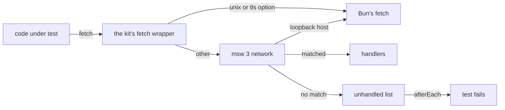

# Fetch mocking and stub servers

- **Status:** draft
- **Decision records:**
  [0005, fetch mocking uses msw 3](../../decisions/0005-fetch-mocking-uses-msw-3.md)

Two subpaths of the [testing kit](./README.md), `@zgeoff/testing`, stand in for HTTP services.
`@zgeoff/testing/fetch` answers the `fetch` calls of the code under test from msw handlers, and
fails the test on a request that no handler matches, even when the code under test catches the
failed fetch. `@zgeoff/testing/server` starts a real stub HTTP server on the loopback interface, for
code that msw can't reach, such as a child process. It needs no msw.

## Shape



msw drops Bun's `unix` and `tls` options from a request it passes through, so the kit wraps `fetch`.
A call with either option skips msw and goes to Bun's own `fetch`.

## Contracts

### The test network

A repo writes one network module, such as `test-utils/network.ts`, and lists it in its test preload.
Tests import `network` from it.

```ts
import { billingHandlers } from '@acme/billing/mocks';
// test-utils/network.ts
import { createTestNetwork } from '@zgeoff/testing/fetch';

export const network = createTestNetwork({ handlers: [...billingHandlers] });
```

```ts
// a test
network.use(http.get('https://api.example.com/v1/invoices/7', () => HttpResponse.json({ id: 7 })));
network.use(http.get('https://api.example.com/v1/invoices/8', () => HttpResponse.error())); // a network failure, on purpose
```

```text
# a test whose code fetched an unmocked URL, and caught the error
error: the test sent requests that no handler matches:
  GET https://api.example.com/v1/invoices/9
```

```ts
// @zgeoff/testing/fetch
function createTestNetwork(options: {
  readonly handlers: readonly RequestHandler[]; // the defaults, kept after each test's reset
  readonly passthroughHosts?: readonly string[]; // default ['127.0.0.1', '[::1]', 'localhost']
}): TestNetwork;

interface TestNetwork {
  use(...handlers: readonly RequestHandler[]): void; // until the test ends
}
```

`TestNetwork` has no reset or close method: the network resets its handlers after each test and
closes after the last file. To test a failed request, a test adds a handler that returns
`HttpResponse.error()`.

### Stub servers

```ts
const api = startStubServer(async (request) =>
  Response.json({ ok: true, path: new URL(request.url).pathname }),
);
// → { url: 'http://127.0.0.1:43121', requests: [], stop: [Function] }, stopped after the test

await run(['./bin/sync'], { env: { API_URL: api.url } });
api.requests; // → [{ method: 'POST', path: '/v1/sync', headers: { … }, body: '{"since":0}' }]

const silent = startStubServer(() => new Promise<Response>(() => {})); // never answers
```

```ts
// @zgeoff/testing/server
function startStubServer(
  handle: (request: Request) => Response | Promise<Response>,
  options?: { readonly cleanup?: 'test' | 'manual' }, // default 'test'; see the README's Cleanup section
): StubServer;

interface StubServer {
  readonly url: string; // http://127.0.0.1:<port>, no trailing slash
  readonly requests: readonly RecordedRequest[]; // in arrival order
  stop(): Promise<void>; // closes open connections too
}

interface RecordedRequest {
  readonly method: string;
  readonly path: string; // pathname and search
  readonly headers: Readonly<Record<string, string>>;
  readonly body: string;
}
```

## Constraints

- `createTestNetwork` builds the network with msw's `defineNetwork` and one `FetchInterceptor` from
  `@mswjs/interceptors/fetch/web`. Under Bun, the interceptor from `@mswjs/interceptors/fetch`
  answers no request and lets unmatched requests reach the real network.
- The optional peer ranges, `msw` `>=3.0.4 <4` and `@mswjs/interceptors` `>=0.45.11 <0.46`, start at
  the versions where a test under Bun 1.4.3 showed the `fetch/web` interceptor answering matched
  requests and rejecting unmatched ones.
- `createTestNetwork` throws when a network already exists in the process. Two networks patch the
  same `fetch`, so one network's handlers would answer the other's requests.
- `createTestNetwork` registers `beforeAll` to enable the network, `afterEach` to reset its handlers
  and check for unmatched requests, and `afterAll` to disable it. It never enables the network when
  its module loads.
- A repo calls `createTestNetwork` only from a module that its test preload lists, so the hooks
  apply to every test file. The kit can't detect a call from elsewhere. Under `bun test --parallel`,
  a preload's `afterAll` runs once per file, and the `beforeAll` enables the network again for the
  next file.
- A request with no matching handler rejects with msw's error, and the network adds it to a list.
  The `afterEach` fails the test with every request on that list, then empties the list.
- A request to a `passthroughHosts` host passes through to the real network.
- Enabling the network patches `fetch` through msw first, and then wraps the patched
  `globalThis.fetch`. Disabling it removes the wrapper, then msw's patch.
- The network never intercepts `WebSocket`.
- `startStubServer` listens on `127.0.0.1`, port 0, through `Bun.serve`. With `cleanup: 'test'`, it
  releases the server after the test through `registerTestCleanup`, from the kit's root export.
- `stop` closes open connections, so a server that never answers still stops.
- `startStubServer` records each request before it calls `handle`.

## Decisions

- **The kit owns the msw setup.** A repo passes only its handlers. The kit chooses the interceptor,
  routes `unix` and `tls` calls to Bun's `fetch`, and checks for unmatched requests.
- **Unmatched requests fail the test in `afterEach`.** Code under test can catch a rejected fetch,
  so a test that relied on the rejection alone could pass.
- **Stub servers have their own subpath,** so a repo that tests a child process installs no msw.

## Builder decides

- The wording of the unmatched-request error, apart from listing each method and URL.
- Which types `@zgeoff/testing/fetch` and `@zgeoff/testing/server` export beside the ones above.

## Out of scope

- WebSocket mocking.
- `@msw/data` collections. A repo builds its own stateful handlers on top of `createTestNetwork`.
