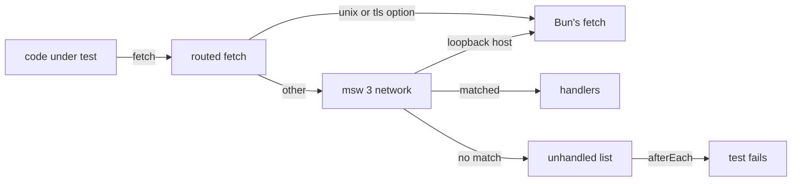

# Fetch mocking and stub servers

- **Status:** draft
- **Decision records:** [0005](../../decisions/0005-fetch-mocking-uses-msw-3.md)

`./fetch` answers the `fetch` calls of the code under test from MSW handlers, and fails the test on
a request that no handler matches, even when the code swallows the failed fetch. For code that MSW
can't reach, such as a child process, `./fetch` also starts a real stub HTTP server on the loopback
interface.

## Shape



## Contracts

### The test network

```ts
import { billingHandlers } from '@acme/billing/mocks';
// a repo's network module, which its test preload imports
import { createTestNetwork } from '@zgeoff/testing/fetch';

export const network = createTestNetwork({ handlers: [...billingHandlers] });
```

```ts
// a test
network.use(http.get('https://api.example.com/v1/invoices/7', () => HttpResponse.json({ id: 7 })));
```

```text
# a test whose code fetched an unmocked URL, and swallowed the error
error: the test sent requests that no handler matches:
  GET https://api.example.com/v1/invoices/8
```

```ts
// ./fetch
function createTestNetwork(options: {
  readonly handlers: readonly RequestHandler[]; // the defaults; resetHandlers keeps them
  readonly passthroughHosts?: readonly string[]; // default ['127.0.0.1', '[::1]', 'localhost']
}): TestNetwork;

interface TestNetwork {
  use(...handlers: readonly RequestHandler[]): void; // until the test ends
}
```

### Stub servers

```ts
const api = startStubServer(async (request) =>
  Response.json({ ok: true, path: new URL(request.url).pathname }),
);
// → { url: 'http://127.0.0.1:43121', requests: [], stop: [Function] }

await run(['./bin/sync'], { env: { API_URL: api.url } });
api.requests; // → [{ method: 'POST', path: '/v1/sync', headers: { … }, body: '{"since":0}' }]

const silent = startStubServer(() => new Promise<Response>(() => {})); // never answers
```

```ts
// ./fetch
function startStubServer(handle: (request: Request) => Response | Promise<Response>): StubServer;

interface StubServer {
  readonly url: string; // http://127.0.0.1:<port>, no trailing slash
  readonly requests: readonly RecordedRequest[]; // in arrival order
  stop(): Promise<void>; // closes open connections too
}

interface RecordedRequest {
  readonly method: string;
  readonly path: string; // pathname and search
  readonly headers: Readonly<Record<string, string>>;
  readonly body: string;
}
```

## Constraints

- `createTestNetwork` builds the network with `defineNetwork` and one `FetchInterceptor` from
  `@mswjs/interceptors/fetch/web`. Under Bun, the interceptor from `@mswjs/interceptors/fetch` mocks
  nothing and lets unhandled requests reach the network.
- `createTestNetwork` throws when a network already exists in the process. Two networks patch the
  same `fetch`, so one network's handlers answer the other's requests.
- `createTestNetwork` registers `beforeAll` to enable the network, `afterEach` to reset its handlers
  and check for unhandled requests, and `afterAll` to disable it. It never enables the network when
  its module loads.
- `createTestNetwork` runs only from a module that the test preload imports. Under
  `bun test --parallel`, a preload's `afterAll` runs once per file, and the `beforeAll` enables the
  network again for the next file.
- A request with no matching handler rejects with MSW's error, and the network adds it to a list.
  The `afterEach` fails the test with every request on that list, then empties it.
- A request to a `passthroughHosts` host passes through to the real network.
- After it enables MSW, the network wraps `globalThis.fetch`. A call with Bun's `unix` or `tls`
  option goes to Bun's own `fetch`, because MSW drops both options from a request it passes through.
- The network never intercepts `WebSocket`.
- `startStubServer` listens on `127.0.0.1`, port 0, through `Bun.serve`. It registers `stop` with
  `registerTestCleanup`.
- `stop` closes open connections, so a server that never answers still stops.
- `startStubServer` records each request before it calls `handle`.

## Decisions

- **The kit owns the MSW setup.** A repo passes its handlers, and gets the interceptor choice, the
  unix-socket routing and the unhandled-request check with them.
- **Unhandled requests fail in `afterEach`.** Code under test can catch a rejected fetch, so the
  rejection alone can't be trusted to fail the test.

## Builder decides

- The wording of the unhandled-request error, apart from listing each method and URL.
- Whether `TestNetwork` exposes more of MSW's network API.

## Out of scope

- WebSocket mocking.
- `@msw/data` collections. A repo builds its own stateful handlers on top of `createTestNetwork`.
