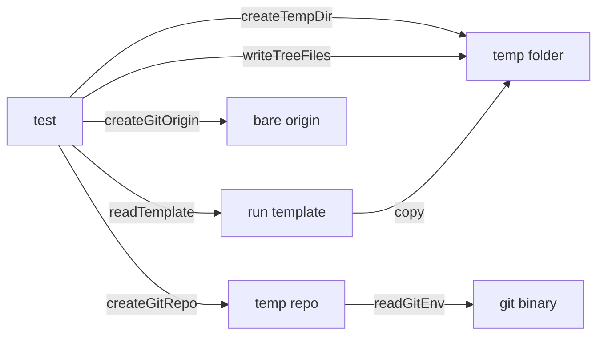

# Files and git

- **Status:** draft

`./fs` makes temp folders that clean up after the test, writes file trees, and builds an expensive
fixture folder once per test run, shared by every worker. `./git` builds temp repos and origins
whose git ignores the user's config, signs nothing and runs no background maintenance.

## Shape



## Contracts

### Temp folders and trees

```ts
const dir = createTempDir('stub-gh');
// → { path: '/tmp/zgt-4026531836-stub-gh-k3Qd9a', remove: [Function] }
// removed after the test; dir.remove() removes it early

await writeTreeFiles(dir.path, {
  'config/app.json': '{"port":4310}\n',
  'old.txt': null, // deletes old.txt
  current: { symlink: 'config/app.json' },
});
```

```ts
// ./fs
function createTempDir(name: string): { readonly path: string; readonly remove: () => void };
function readRunFolderPrefix(name: string, source?: PIDNamespaceSource): string; // existing signature

function writeTreeFiles(
  directory: string,
  files: Readonly<Record<string, string | null | { readonly symlink: string }>>,
): Promise<void>;
```

### The run template

```ts
const template = await readTemplate({
  name: 'built-site',
  root: packageRoot,
  inputs: ['src/**', 'package.json'], // a change to any input builds a new template
  write: async (directory) => {
    await run(['bun', 'run', 'build', '--outdir', directory]);
  },
});
// → '/tmp/zgt-4026531836-templates/built-site-5e1f…'; copy it, never write into it
```

```ts
// ./fs
interface ReadTemplateOptions {
  readonly name: string;
  readonly root: string; // the inputs' globs resolve under this folder
  readonly inputs: readonly string[];
  readonly write: (directory: string) => Promise<void>;
  readonly staleLockMs?: number; // default 120_000; a lock older than this belongs to a dead build
}
function readTemplate(options: ReadTemplateOptions): Promise<string>;
```

### Git

```ts
const env = readGitEnv(createTempDir('git-home').path);

const repo = await createGitRepo(env, [
  { message: 'add app', files: { 'app.ts': 'export {};\n' } },
  { message: 'drop app', files: { 'app.ts': null }, date: '2026-01-02T00:00:00Z' },
  { message: 'merge', files: {}, parent: 0, merged: 1 },
]);
// → { path: '/tmp/…/repo', commits: ['3f2a…', '9c1b…', 'e04d…'] }

const origin = await createGitOrigin(env);
// → { path: '/tmp/…/origin.git' }, a bare repo with one commit on main

const head = await runGit(repo.path, env, ['rev-parse', 'HEAD']); // → '3f2a…\n'
```

```ts
// ./git
function readGitEnv(home: string, outerEnv?: GitEnv): GitEnv; // existing signature
function runGit(cwd: string, env: GitEnv, args: readonly string[]): Promise<string>; // was void; now stdout
function createGitRepo(env: GitEnv, commits: readonly TestCommit[]): Promise<TestRepo>;
function createGitOrigin(env: GitEnv): Promise<{ readonly path: string }>;
// createGitCommit and readGitHead keep their existing signatures.

interface TestCommit {
  readonly message: string;
  readonly files: Readonly<Record<string, string | null | { readonly symlink: string }>>;
  readonly parent?: number; // index of an earlier commit; default the one before
  readonly merged?: number | readonly number[]; // indexes of commits merged into this one
  readonly date?: string; // ISO 8601; sets both the author and the committer date
}

interface TestRepo {
  readonly path: string;
  readonly commits: readonly string[]; // one sha per TestCommit, in order
}
```

## Constraints

- `createTempDir` is synchronous. It makes the folder under `os.tmpdir()`, with a name that starts
  with `readRunFolderPrefix`, and registers its removal with `registerTestCleanup`.
- A removal repeats up to 10 times while the folder still exists, then throws. Bun's recursive `rm`
  can return without an error and leave the folder when another process deletes an entry during its
  walk.
- `writeTreeFiles` makes each parent folder it needs, and a `null` entry deletes a file that is
  missing without an error.
- `readTemplate` builds a template once per test run, whatever the number of workers. The first
  caller takes a lock folder and builds into a staging folder that it renames into place. Every
  other caller waits for the rename.
- When a lock is older than `staleLockMs`, the next caller takes it over and builds again.
- `readTemplate` keys the template on a hash of the inputs' contents, and deletes the run's older
  templates with the same name.
- `readGitEnv` keeps its existing variables: `PATH`, `HOME` set to `home`, no global or system
  config, a fixed author and committer, and the mise folders.
- `readGitEnv` adds, through `GIT_CONFIG_COUNT`: `commit.gpgsign=false`, `tag.gpgsign=false`,
  `maintenance.auto=false` and `init.defaultBranch=main`.
- `createGitOrigin` also writes `maintenance.auto=false` into the origin's own config. A push runs
  git on the origin side without the `GIT_CONFIG_*` variables.
- `createGitRepo` removes the repo when a commit fails, and then rethrows.
- `runGit` rejects with git's stderr when git exits non-zero.

## Decisions

- **One git env for every git call.** A test passes the env from `readGitEnv` to each helper, so the
  user's global config, signing key or hooks never reach a test repo.
- **The template cache spans workers.** A cache in one process would build once per worker, and the
  builds would race on one folder.

## Builder decides

- The lock folder's name and the poll interval of a waiting caller.
- The fixed author name and email.
- Whether `createGitRepo` runs git through `Bun.$` or `run`.
