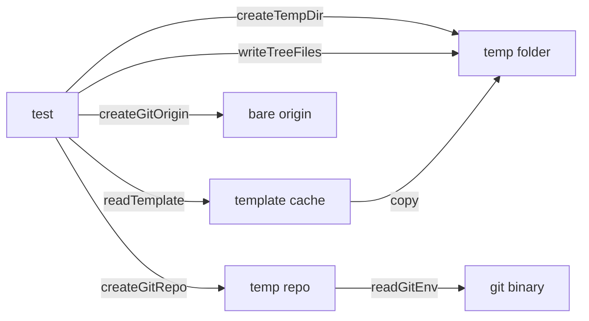

# Files and git

- **Status:** draft

`./fs` makes temp folders that clean up after the test, writes file trees, and keeps a cache of
expensive fixture folders that every worker shares. `./git` builds temp repos and origins whose git
ignores the user's config, signs nothing and runs no background maintenance.

## Shape



## Contracts

### Temp folders and trees

```ts
const dir = createTempDir('stub-gh');
// → { path: '/tmp/stub-ghpid4242-ns4026531836-k3Qd9a', remove: [Function] }
// removed after the test; dir.remove() removes it early

await writeTreeFiles(dir.path, {
  'config/app.json': '{"port":4310}\n',
  'old.txt': null, // deletes old.txt
  'config/current': { symlink: 'app.json' }, // config/current → config/app.json
});
```

```ts
// ./fs
function createTempDir(
  name: string,
  options?: { readonly cleanup?: 'test' | 'manual' },
): { readonly path: string; readonly remove: () => void };

function readRunFolderPrefix(name: string, source?: PIDNamespaceSource): string; // existing signature

function writeTreeFiles(
  directory: string,
  files: Readonly<Record<string, string | null | { readonly symlink: string }>>, // symlink: the target as written, as `ln -s` takes it
): Promise<void>;
```

### The template cache

```ts
const template = await readTemplate({
  name: 'built-site',
  root: packageRoot,
  inputs: ['src/**', 'package.json'], // a change to any input's contents builds a new template
  write: async (directory) => {
    await run(['bun', 'run', 'build', '--outdir', directory]);
  },
});
// → '/tmp/zgeoff-testing-templates/built-site-5e1f…'; copy it, never write into it
```

```ts
// ./fs
interface ReadTemplateOptions {
  readonly name: string;
  readonly root: string; // the inputs' globs resolve under this folder
  readonly inputs: readonly string[];
  readonly write: (directory: string) => Promise<void>;
  readonly staleLockMs?: number; // default 120_000; a lock older than this belongs to a dead build
}
function readTemplate(options: ReadTemplateOptions): Promise<string>;
```

### Git

```ts
const env = readGitEnv(createTempDir('git-home').path);

const repo = await createGitRepo(env, [
  { message: 'add app', files: { 'app.ts': 'export {};\n' } },
  { message: 'add readme', files: { 'README.md': '# app\n' }, date: '2026-01-02T00:00:00Z' },
  { message: 'drop app', files: { 'app.ts': null }, parent: 0 }, // forks from 'add app'
  { message: 'merge readme', files: {}, merged: 1 }, // parents: 'drop app', then 'add readme'
]);
// → { path: '/tmp/repopid4242-ns4026531836-Qm2x8b', commits: ['3f2a…', '9c1b…', 'e04d…', '77aa…'], remove: [Function] }

await runGit(repo.path, env, ['rev-parse', 'HEAD']); // → '77aa…\n', the last commit

const origin = await createGitOrigin(env);
// → { path: '/tmp/originpid4242-ns4026531836-Zt4p1c', remove: [Function] }
```

```ts
// ./git
type GitEnv = Readonly<Record<string, string | undefined>>; // existing type

function readGitEnv(home: string, outerEnv?: GitEnv): GitEnv; // existing signature
function runGit(cwd: string, env: GitEnv, args: readonly string[]): Promise<string>; // was void; now stdout
function createGitRepo(
  env: GitEnv,
  commits: readonly TestCommit[],
  options?: { readonly cleanup?: 'test' | 'manual' },
): Promise<TestRepo>;
function createGitOrigin(
  env: GitEnv,
  options?: { readonly cleanup?: 'test' | 'manual' },
): Promise<{ readonly path: string; readonly remove: () => void }>;
// createGitCommit and readGitHead keep their existing signatures.

interface TestCommit {
  readonly message: string;
  readonly files: Readonly<Record<string, string | null | { readonly symlink: string }>>; // applied on top of the first parent's tree
  readonly parent?: number; // index of an earlier commit, the first parent; default the commit before
  readonly merged?: number | readonly number[]; // indexes of earlier commits, the further parents
  readonly date?: string; // ISO 8601; sets both the author and the committer date
}

interface TestRepo {
  readonly path: string;
  readonly commits: readonly string[]; // one sha per TestCommit, in order
  readonly remove: () => void;
}
```

## Constraints

- `createTempDir` is synchronous. It makes the folder under `os.tmpdir()` with `mkdtemp` and the
  prefix `readRunFolderPrefix(name)`, so a stale-folder sweep, such as the one tools' `bun run test`
  runs first, can remove it after a crashed run.
- A removal repeats up to 10 times while the folder still exists, then throws. Bun's recursive `rm`
  can return without an error and leave the folder when another process deletes an entry during its
  walk.
- `writeTreeFiles` makes each parent folder it needs. A `null` entry deletes the file, and a missing
  file is no error. A symlink entry replaces a file or link already at its path.
- `readTemplate` keeps its templates in one folder under `os.tmpdir()`, named the same in every run.
  A template outlives the test run, and the next run whose inputs hash the same reuses it.
- `readTemplate` builds each template once, whatever the number of workers. The first caller takes a
  lock folder and builds into a staging folder that it renames into place. Every other caller waits
  for the rename.
- When `write` throws, `readTemplate` removes the staging folder, releases the lock and rethrows. A
  waiting caller then takes the lock and builds.
- When a lock is older than `staleLockMs`, the next caller takes it over and builds again.
- After a build, `readTemplate` deletes the older templates with the same name.
- `createGitRepo` and `createGitOrigin` each make their folder with `createTempDir`, so it goes
  after the test.
- `createGitRepo` builds each commit with `git commit-tree`, from the first parent's tree with the
  commit's `files` applied. It never runs `git merge`, so a merge commit has no conflicts and holds
  exactly that tree.
- After `createGitRepo`, `main` and `HEAD` point at the last commit, and the work tree and index
  match it.
- `createGitOrigin` makes a bare repo with one commit on `main`, with the message `initial` and an
  empty tree.
- `readGitEnv` keeps its existing variables: `PATH`, `HOME` set to `home`, no global or system
  config, a fixed author and committer, and the mise folders.
- `readGitEnv` sets, through `GIT_CONFIG_COUNT`: `commit.gpgsign=false`, `tag.gpgsign=false`,
  `maintenance.auto=false` and `init.defaultBranch=main`. It replaces any `GIT_CONFIG_COUNT` in
  `outerEnv`.
- `createGitOrigin` also writes `maintenance.auto=false` into the origin's own config. A push runs
  git on the origin side without the `GIT_CONFIG_*` variables.
- `createGitRepo` removes the repo when a commit fails, and then rethrows.
- `runGit` rejects with an error that holds git's stderr when git exits non-zero.

## Decisions

- **One git env for every git call.** A test passes the env from `readGitEnv` to each helper, so the
  user's global config, signing key or hooks never reach a test repo.
- **The template cache spans workers and runs.** A cache in one process would build once per worker,
  and the builds would race on one folder.

## Builder decides

- The lock folder's name and the poll interval of a waiting caller.
- Whether `createGitRepo` runs git through `Bun.$` or `runGit`.
