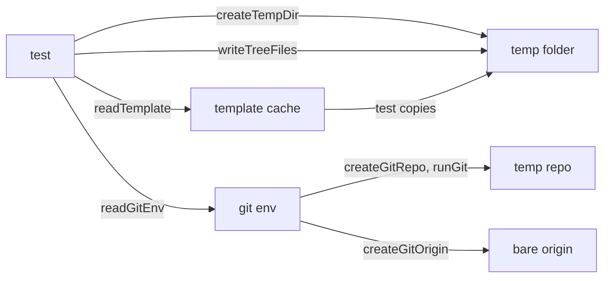

# Files and git

- **Status:** draft

Two subpaths of the [testing kit](./README.md), `@zgeoff/testing`, cover a test's files.
`@zgeoff/testing/fs` makes temp folders that the kit removes after the test, writes trees of files,
and caches template folders that are slow to build, such as a built site, for every test worker to
copy. `@zgeoff/testing/git` builds temp repos and bare origins. Each git call runs with an env from
`readGitEnv`, so it ignores the user's git config, signs nothing and starts no background
maintenance.

## Shape



## Contracts

### Temp folders and trees

```ts
const dir = createTempDir('stub-gh');
// → { path: '/tmp/stub-ghpid4242-ns4026531836-k3Qd9a', remove: [Function] }

await writeTreeFiles(dir.path, {
  'config/app.json': '{"port":4310}\n',
  'old.txt': null, // deletes old.txt
  'config/current': { symlink: 'app.json' }, // config/current → config/app.json
});
```

```ts
// @zgeoff/testing/fs
function createTempDir(
  name: string,
  options?: { readonly cleanup?: 'test' | 'manual' }, // default 'test'; see the README's Cleanup section
): { readonly path: string; readonly remove: () => void };

// existing: the folder-name prefix `<name>pid<pid>-ns<pid namespace>-`; `source` lets a test fake the platform
function readRunFolderPrefix(name: string, source?: PIDNamespaceSource): string;

function writeTreeFiles(
  directory: string,
  files: Readonly<Record<string, string | null | { readonly symlink: string }>>, // symlink: the target as written, as `ln -s` takes it
): Promise<void>;
```

### The template cache

```ts
const template = await readTemplate({
  name: 'built-site',
  root: packageRoot,
  inputs: ['src/**', 'package.json'],
  write: async (directory) => {
    await run(['bun', 'run', 'build', '--outdir', directory]);
  },
});
// → '/tmp/zgeoff-testing-templates/built-site-5e1f…'

cpSync(template, dir.path, { recursive: true }); // the test copies it, and never writes into it
```

```ts
// @zgeoff/testing/fs
interface ReadTemplateOptions {
  readonly name: string;
  readonly root: string; // the inputs' globs resolve under this folder
  readonly inputs: readonly string[]; // the key hashes the name, and each matched file's relative path and contents
  readonly write: (directory: string) => Promise<void>; // builds the template into an empty folder
  readonly staleLockMs?: number; // default 120_000; a lock older than this belongs to a dead build
}
function readTemplate(options: ReadTemplateOptions): Promise<string>;
```

### Git

```ts
const env = readGitEnv(createTempDir('git-home').path);

const repo = await createGitRepo(env, [
  { message: 'add app', files: { 'app.ts': 'export {};\n' } },
  { message: 'add readme', files: { 'README.md': '# app\n' }, date: '2026-01-02T00:00:00Z' },
  { message: 'drop app', files: { 'app.ts': null }, parent: 0 }, // a second line of history, from 'add app'
  { message: 'merge readme', files: { 'README.md': '# app\n' }, merged: 1 }, // parents: 'drop app', 'add readme'
]);
// → { path: '/tmp/repopid4242-ns4026531836-Qm2x8b', commits: ['3f2a…', '9c1b…', 'e04d…', '77aa…'], remove: [Function] }

await runGit(repo.path, env, ['rev-parse', 'HEAD']); // → '77aa…\n'

const origin = await createGitOrigin(env);
// → { path: '/tmp/originpid4242-ns4026531836-Zt4p1c', remove: [Function] }, empty
await runGit(repo.path, env, ['push', origin.path, 'main']);
```

```ts
// @zgeoff/testing/git
type GitEnv = Readonly<Record<string, string | undefined>>;

function readGitEnv(home: string, outerEnv?: GitEnv): GitEnv; // outerEnv defaults to process.env
function runGit(cwd: string, env: GitEnv, args: readonly string[]): Promise<string>; // resolves with stdout
function createGitRepo(
  env: GitEnv,
  commits: readonly TestCommit[],
  options?: { readonly cleanup?: 'test' | 'manual' },
): Promise<TestRepo>;
function createGitOrigin(
  env: GitEnv,
  options?: { readonly cleanup?: 'test' | 'manual' },
): Promise<{ readonly path: string; readonly remove: () => void }>;
// existing: writes, stages and commits; resolves with the sha. `files` widens to the TestCommit form.
function createGitCommit(repo: string, env: GitEnv, files: TestCommit['files']): Promise<string>;
function readGitHead(repo: string, env: GitEnv): Promise<string>; // existing: the sha of HEAD

interface TestCommit {
  readonly message: string;
  readonly files: Readonly<Record<string, string | null | { readonly symlink: string }>>; // applied on top of the first parent's tree
  readonly parent?: number; // index of an earlier commit, the first parent; default the commit before
  readonly merged?: number | readonly number[]; // indexes of earlier commits, the further parents
  readonly date?: string; // ISO 8601; sets both the author and the committer date; default 2026-01-01T00:00:00Z, so shas repeat across runs
}

interface TestRepo {
  readonly path: string;
  readonly commits: readonly string[]; // one sha per TestCommit, in order
  readonly remove: () => void;
}
```

## Constraints

- `createTempDir` is synchronous. It makes the folder under `os.tmpdir()` with `mkdtemp` and the
  prefix `readRunFolderPrefix(name)`. A stale-folder sweep, such as the one that the tools repo's
  `bun run test` runs first, then finds the folder after a crashed run.
- Every removal in these two subpaths, early or after the test, runs `rm` up to 10 times while the
  folder still exists, then throws. Bun's recursive `rm` can return without an error and leave the
  folder when another process deletes an entry during its walk.
- `writeTreeFiles` makes each parent folder it needs. A `null` entry deletes the file, and a missing
  file is no error. A symlink entry replaces a file or link already at its path.
- `readTemplate` keeps every template in one folder under `os.tmpdir()`, with the same name in every
  run. A later run whose inputs have the same hash uses the template again with no build.
- `readTemplate` builds each template once, however many workers ask for it. The first caller takes
  a lock folder and builds into a staging folder, which it renames into place. Every other caller
  waits for the rename.
- When `write` throws, `readTemplate` removes the staging folder, releases the lock and rethrows. A
  caller that waits then takes the lock and builds.
- A running build refreshes its lock at least every `staleLockMs / 4`. When a lock is older than
  `staleLockMs`, the next caller to find it takes it over and starts the build from the start.
- After a build, `readTemplate` deletes each template of the same name with another hash that was
  last used more than 1 hour ago. A run that still copies an older template keeps it.
- `createGitRepo` and `createGitOrigin` make their folders with `createTempDir`, and pass `cleanup`
  on to it.
- `createGitRepo` builds each commit with `git commit-tree`, from the first parent's tree with the
  commit's `files` applied. It never runs `git merge`, so a merge commit has no conflicts and holds
  exactly that tree.
- After `createGitRepo`, `main` and `HEAD` point at the last commit, and the work tree and index
  match it.
- `createGitOrigin` makes an empty bare repo, so a test's first push to it succeeds.
- `readGitEnv` passes `PATH` and mise's data and state folders on from `outerEnv`, sets `HOME` to
  `home`, turns off the global and system config, and sets a fixed author and committer. A tool on
  `PATH` can be a mise shim, and mise refuses to run from a `HOME` that lacks its installs.
- `readGitEnv` sets, through `GIT_CONFIG_COUNT`: `commit.gpgsign=false`, `tag.gpgsign=false`,
  `maintenance.auto=false` and `init.defaultBranch=main`. It replaces any `GIT_CONFIG_COUNT` in
  `outerEnv`.
- `createGitOrigin` also writes `maintenance.auto=false` into the origin's own config. A push runs
  git on the origin side without the `GIT_CONFIG_*` variables.
- `createGitRepo` throws on an empty `commits` list. It removes the repo when a commit fails, and
  then rethrows.
- `runGit` rejects with an error that holds git's stderr when git exits non-zero.

## Decisions

- **One git env for every git call.** A test passes the env from `readGitEnv` to each helper, so the
  user's global config, signing key or hooks never reach a test repo.
- **The template cache spans workers and runs.** A cache in one process would build once per worker,
  and the builds would race on one folder. A cache that outlives the run skips the build in every
  later run until an input changes.

## Builder decides

- The lock folder's name and the poll interval of a waiting caller.
- How `readTemplate` records when a template was last used.
- Whether `createGitRepo` runs git through `Bun.$` or `runGit`.
