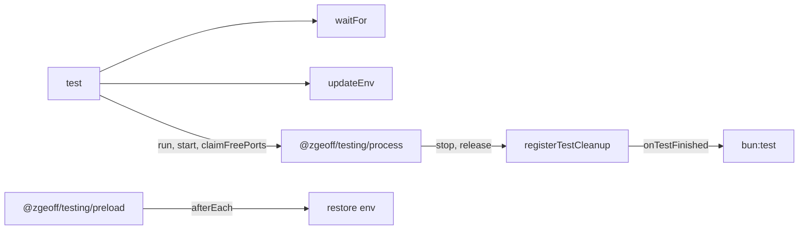

# Waiting, env, cleanup and processes

- **Status:** draft

The root export of the [testing kit](./README.md), `@zgeoff/testing`, holds the helpers that almost
every test file needs: `waitFor`, `updateEnv`, `removeEnvOverrides` and `registerTestCleanup`.
`@zgeoff/testing/preload` restores the env after each test. `@zgeoff/testing/process` runs programs
and claims free ports, and `@zgeoff/testing/mocks` holds stub functions to pass to Bun's `mock()`.

## Shape



## Contracts

### Waiting

```ts
const line = await waitFor(() => readLogLine(logPath, 'ready'), {
  label: 'the ready line',
  timeoutMs: 2000,
});
// → 'server ready on 4310'
// or throws: Error('timed out after 2000 ms waiting for the ready line', { cause: lastError })
```

```ts
// @zgeoff/testing
function waitFor<T>(attempt: () => T | Promise<T>, options?: WaitForOptions): Promise<T>;

interface WaitForOptions {
  readonly intervalMs?: number; // default 20
  readonly timeoutMs?: number; // default 5000
  readonly label?: string; // names what the test waits for, in the timeout message
  readonly signal?: AbortSignal; // an abort stops the wait and rejects with signal.reason
  readonly progress?: () => unknown; // when its value changes between attempts (Object.is), the deadline starts again
  readonly now?: () => number; // default performance.now
  readonly sleep?: (delayMs: number) => Promise<void>; // default Bun.sleep
}
```

### Env

```ts
updateEnv('GH_TOKEN', 'test-token'); // sets it until the test ends
updateEnv('HOME', undefined); // deletes it until the test ends
```

```ts
// @zgeoff/testing
function updateEnv(name: string, value: string | undefined): void;
function removeEnvOverrides(): void; // puts back every value updateEnv changed; for a repo that wires its own preload
```

### Cleanup

```ts
const release = registerTestCleanup(() => server.stop(true));
await release(); // early release; the after-test run then skips it
```

```ts
// @zgeoff/testing
// The returned function runs `release` at most once; a later call returns the first call's result.
function registerTestCleanup<T>(release: () => T): () => T;
```

### The preload

```toml
# a repo's bunfig.toml
[test]
preload = ["@zgeoff/testing/preload", "./test-utils/network.ts"]
```

`@zgeoff/testing/preload` registers one `afterEach` that calls `removeEnvOverrides`. A repo that
mocks fetch lists its network module beside it, and `createTestNetwork` registers that module's
hooks, as [fetch.md](./fetch.md) says.

### Processes

```ts
const result = await run(['git', 'status'], { cwd: repo, timeoutMs: 5000 });
// → { exitCode: 0, stdout: 'On branch main\n', stderr: '' }

await using server = await start([process.execPath, 'serve.ts'], {
  ready: { stdout: /listening/u },
});
```

```ts
// @zgeoff/testing/process. Only the fields shown change; every other field stays as the code has it.
function run(command: readonly string[], options?: RunOptions): Promise<RunResult>;
function start(command: readonly string[], options?: StartOptions): Promise<ProcessHandle>;
// resolves with everything read from the stream once the text appears
function readStreamUntil(stream: ReadableStream<Uint8Array>, text: string): Promise<string>;

interface StartOptions {
  // …existing fields: args, env, cwd, port, ready, readyTimeoutMs
  readonly cleanup?: 'test' | 'manual'; // default 'test'; see the README's Cleanup section
}

interface ProcessHandle extends AsyncDisposable {
  // …existing fields: url, port, pid, readyLine, write, waitForLine, output
  readonly stop: (signal?: Signal) => Promise<number>; // now also releases the port claim
}
```

### Ports

```ts
const ports = claimFreePorts(2);
const apiPort = ports.take(); // → 61234
const adminPort = ports.take(); // → 59877
ports.take(); // throws: only 2 free ports were asked for
ports.release(); // early release; otherwise after the test
```

```ts
// @zgeoff/testing/process
function claimFreePorts(
  count: number,
  options?: { readonly cleanup?: 'test' | 'manual' }, // default 'test'
): { take(): number; release(): void };
```

### Stub functions

`@zgeoff/testing/mocks` keeps the five helpers it takes from `./helpers`, with their signatures:

- `makeAnswerQueue(answers)` returns a function that gives the next answer on each call, and throws
  once they run out;
- `makeRepeatingAnswerQueue(answers)` gives the next answer on each call, and repeats the last one;
- `makeResolvingStub(value)` and `makeRejectingStub(error)` return a `mock()` that resolves with the
  value or rejects with the error;
- `createBlockingStubKit(value)` returns a `mock()` that reports its first call and waits for the
  test to release it.

## Constraints

- `waitFor` measures its deadline with `now`, so a change of the wall clock never ends a wait early.
- `waitFor` never starts an attempt after the deadline. While an attempt hangs, `waitFor` races it
  against `sleep` for the time left, and rejects at the deadline. The hung attempt keeps running,
  and `waitFor` ignores its result.
- A wait resolves with any value the attempt returns, `false`, `null` and `undefined` included. Only
  a throw or a rejection asks for another try.
- When `progress` is set, `waitFor` reads it after each attempt. A wait whose progress value changes
  before each deadline has no limit.
- `registerTestCleanup` runs its releases after the test in reverse order of registration. It runs
  every release, even after one throws, and then throws an `AggregateError` of every failure.
- A release runs at most once, whether the test calls it early or the after-test run calls it.
- `registerTestCleanup` adds one `onTestFinished` hook per test, however many releases the test
  registers. A test calls it inside a test or a `beforeEach`. In a `beforeAll`, Bun runs the hook at
  once, so a fixture made there passes `cleanup: 'manual'`, as the README's
  [Cleanup](./README.md#cleanup) section shows.
- `run` and `start` pass the child an explicit env: `process.env`, with `options.env` on top. A Bun
  child started with no `env` gets the env the process started with, and misses each `updateEnv`
  change.
- `run` and `start` start the child in its own process group. A timeout or a `stop` signals the
  whole group.
- When a signal to a process group fails with `ESRCH` or `EPERM`, the kit treats the group as gone.
  macOS returns `EPERM` for a group whose leader has exited.
- With `cleanup: 'test'`, `start` registers its `stop` with `registerTestCleanup`. A test that
  forgets `await using` still has its process stopped.
- When `port` is not set, `start` takes its port from `claimFreePorts(1)` and holds the claim until
  `stop`.
- A port claim keeps out every other kit caller, in any process, for as long as it lasts. A program
  that binds the port without the kit can still take it.
- On Linux, `claimFreePorts` picks each port below the start of the kernel's ephemeral range, which
  it reads from `ip_local_port_range`. It holds each port by binding an abstract unix socket named
  after the port, and skips a port that `/proc/net/tcp` or `/proc/net/tcp6` lists as busy.
- On macOS, `claimFreePorts` binds port 0 to pick each port and holds nothing, so a parallel test
  can race for the port.

## Decisions

- **`waitFor` retries on a throw.** The attempt returns the value the test wants, or throws to ask
  for another try, so the attempt's last error becomes the timeout's cause.
- **A repo lists the preload in `bunfig.toml`.** A test file never imports it, so every file gets
  the env restore, including a file whose author forgot it.

## Builder decides

- How `claimFreePorts` names its abstract sockets, and how many picks it tries before it throws.
- The timeout message's wording, apart from naming the label and the timeout.
