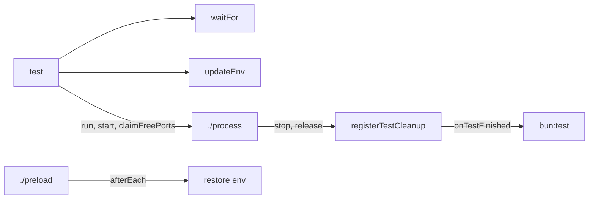

# Waiting, env, cleanup and processes

- **Status:** draft

The root export holds the helpers almost every test file needs: `waitFor`, `updateEnv`,
`removeEnvOverrides` and `registerTestCleanup`. `./preload` wires their global hook. `./process`
runs programs and claims ports, and `./mocks` holds the stub functions for `mock()`.

## Shape



## Contracts

### Waiting

```ts
const line = await waitFor(() => readLogLine(logPath, 'ready'), {
  label: 'the ready line',
  timeoutMs: 2000,
});
// → 'server ready on 4310'
// or throws: Error('timed out after 2000 ms waiting for the ready line', { cause: lastError })
```

```ts
// root export
function waitFor<T>(attempt: () => T | Promise<T>, options?: WaitForOptions): Promise<T>; // existing signature

interface WaitForOptions {
  readonly intervalMs?: number; // existing; default 20
  readonly timeoutMs?: number; // existing; default 5000
  readonly label?: string; // existing; names what the test waits for, in the timeout message
  readonly signal?: AbortSignal; // an abort stops the wait and rejects with signal.reason
  readonly progress?: () => unknown; // when its value changes between attempts (Object.is), the deadline starts again
  readonly now?: () => number; // default performance.now
  readonly sleep?: (delayMs: number) => Promise<void>; // default Bun.sleep; also times a hung attempt
}
```

### Env

```ts
updateEnv('GH_TOKEN', 'test-token'); // sets it until the test ends
updateEnv('HOME', undefined); // deletes it until the test ends
```

```ts
// root export, both existing signatures
function updateEnv(name: string, value: string | undefined): void;
function removeEnvOverrides(): void; // puts back every value updateEnv changed; for a repo that wires its own preload
```

### Cleanup

```ts
const release = registerTestCleanup(() => server.stop(true));
await release(); // early release; the after-test run then skips it
```

```ts
// root export
function registerTestCleanup<T>(release: () => T): () => T; // a second call returns the first call's result
```

### The preload

```toml
# a repo's bunfig.toml
[test]
preload = ["@zgeoff/testing/preload", "./test-utils/preload.ts"]
```

Importing `@zgeoff/testing/preload` registers an `afterEach` that calls `removeEnvOverrides`. The
test network registers its own hooks, as [fetch.md](./fetch.md) says.

### Processes

```ts
const result = await run(['git', 'status'], { cwd: repo, timeoutMs: 5000 });
// → { exitCode: 0, stdout: 'On branch main\n', stderr: '' }

await using server = await start([process.execPath, 'serve.ts'], {
  ready: { stdout: /listening/u },
});
```

```ts
// ./process. Every type keeps its existing fields; only StartOptions gains one.
function run(command: readonly string[], options?: RunOptions): Promise<RunResult>;
function start(command: readonly string[], options?: StartOptions): Promise<ProcessHandle>;
function readStreamUntil(stream: ReadableStream<Uint8Array>, text: string): Promise<string>; // existing, moved from ./helpers

interface RunOptions {
  readonly args?;
  readonly env?;
  readonly cwd?;
  readonly input?;
  readonly timeoutMs?;
}
interface RunResult {
  readonly exitCode: number;
  readonly stdout: string;
  readonly stderr: string;
}

interface StartOptions {
  // …existing fields: args, env, cwd, port, ready, readyTimeoutMs
  readonly cleanup?: 'test' | 'manual'; // default 'test'
}

interface ProcessHandle extends AsyncDisposable {
  // …existing fields: url, port, pid, readyLine, write, waitForLine, output
  readonly stop: (signal?: Signal) => Promise<number>; // existing; also releases the port claim
}
```

### Ports

```ts
const ports = claimFreePorts(2);
const apiPort = ports.take(); // → 61234
const adminPort = ports.take(); // → 59877
ports.take(); // throws: only 2 free ports were asked for
ports.release(); // early release; otherwise after the test
```

```ts
// ./process
function claimFreePorts(
  count: number,
  options?: { readonly cleanup?: 'test' | 'manual' },
): { take(): number; release(): void };
```

`readFreePort` is removed: `claimFreePorts(1).take()` replaces it.

### Stub functions

`./mocks` exports `makeAnswerQueue`, `makeRepeatingAnswerQueue`, `makeResolvingStub`,
`makeRejectingStub` and `createBlockingStubKit`, each with its existing signature.

## Constraints

- `waitFor` measures its deadline with `now`, which defaults to `performance.now`, so a change of
  the wall clock never ends a wait early.
- `waitFor` starts no attempt after the deadline. A hung attempt races `sleep` for the time left,
  and still ends the wait at the deadline.
- When `progress` is set, `waitFor` reads it after each attempt. A wait whose progress value keeps
  changing runs past `timeoutMs`.
- `registerTestCleanup` runs its releases after the test in reverse order of registration. It runs
  every release, even after one throws, and then throws an `AggregateError` of every failure.
- A release runs at most once, whether the test calls it early or the after-test run calls it.
- `registerTestCleanup` adds one `onTestFinished` hook per test, however many releases the test
  registers. Call it inside a test or a `beforeEach`. The README's [Cleanup](./README.md#cleanup)
  section says what a `beforeAll` fixture does.
- `run` and `start` pass the child an explicit env: `process.env` merged with `options.env`. A Bun
  child started with no `env` gets the env the process started with and misses each `updateEnv`
  change.
- `run` and `start` start the child in its own process group. A timeout or a `stop` signals the
  whole group.
- When a signal to a process group fails with `ESRCH` or `EPERM`, the kit treats the group as gone.
  macOS returns `EPERM` for a group whose leader has exited.
- With `cleanup: 'test'`, `start` registers its `stop` with `registerTestCleanup`, so a test that
  forgets `await using` still leaves no process behind.
- When `port` is not set, `start` takes its port from `claimFreePorts(1)` and holds the claim until
  `stop`.
- On Linux, `claimFreePorts` picks each port below the start of the kernel's ephemeral range, which
  it reads from `ip_local_port_range`. It holds each port by binding an abstract unix socket named
  after the port, and skips a port that `/proc/net/tcp` or `/proc/net/tcp6` lists as busy.
- A process that binds a claimed port without a claim can still race for it.

## Decisions

- **`waitFor` retries on a throw.** The attempt returns the value the test wants, or throws to ask
  for another try, so the attempt's last error becomes the timeout's cause.
- **The preload is opt-in by import.** A repo lists `@zgeoff/testing/preload` in `bunfig.toml`, and
  a test file never imports it.

## Builder decides

- How `claimFreePorts` names its abstract sockets, and how many picks it tries before it throws.
- The timeout message's wording, apart from naming the label and the timeout.
