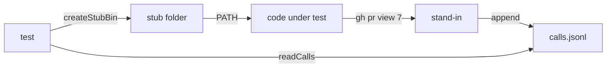

# Stub binaries

- **Status:** draft

`./bin` writes a stand-in for a command, such as `gh` or `op`, into a folder that a test puts first
on `PATH`. The stand-in answers each call from a list the test gives, records every call to a log,
and fails loudly on a call nobody scripted.

## Shape



## Contracts

```ts
const bin = createTempDir('stub-bin').path;

const gh = createStubBin(bin, 'gh', {
  answers: [
    { args: ['pr', 'view'], stdout: '{"number":7}\n' },
    { args: ['pr', 'merge'], exitCode: 1, stderr: 'merge conflict\n' },
    { args: ['pr', 'merge'], stdout: '' }, // the second `gh pr merge` call succeeds
  ],
  recordEnv: ['GH_TOKEN'],
  recordStdin: true,
});
updateEnv('PATH', `${bin}:${process.env.PATH}`);

// …the code under test runs `gh pr view 7 --json number`…

gh.readCalls();
// → [{ name: 'gh', argv: ['pr', 'view', '7', '--json', 'number'], cwd: '/tmp/…/repo',
//      env: { GH_TOKEN: 'test-token' }, stdin: '' }]
```

```ts
const sudo = createStubBin(bin, 'sudo', { script: '#!/bin/sh\nexec "$@"\n' });
linkCommands(bin, ['git', 'jq']); // symlinks the real git and jq from PATH into bin
readStubCalls(bin); // → every call to every stand-in in bin, in call order
```

```ts
// ./bin
function createStubBin(directory: string, name: string, options?: StubBinOptions): StubBin;
function readStubCalls(directory: string): readonly StubCall[]; // a folder with no log reads as []
function linkCommands(directory: string, names: readonly string[]): void; // throws on a name PATH lacks

type StubBinOptions =
  | {
      readonly answers?: readonly StubAnswer[]; // no answers: every call exits 0 with no output
      readonly recordEnv?: readonly string[]; // env names to copy into each call's record
      readonly recordStdin?: boolean; // default false: the stand-in never reads stdin
    }
  | {
      readonly script: string; // a script with its own shebang
      readonly recordEnv?: readonly string[];
      readonly recordStdin?: boolean;
    };

interface StubAnswer {
  readonly args: readonly string[]; // matches a call whose argv starts with these
  readonly exitCode?: number; // default 0
  readonly stdout?: string;
  readonly stderr?: string;
}

interface StubBin {
  readonly path: string; // <directory>/<name>
  readCalls(): readonly StubCall[]; // this stand-in's calls only
}

interface StubCall {
  readonly name: string;
  readonly argv: readonly string[]; // exactly as the stand-in received them
  readonly cwd: string;
  readonly env: Readonly<Record<string, string>>; // only the recordEnv names that were set
  readonly stdin: string; // '' unless recordStdin; with it, all of stdin up to EOF, or '' when stdin is a terminal
}
```

`createStubSudo` moves to `./bin` with its existing signature.

## Constraints

- `createStubBin`, `readStubCalls` and `linkCommands` are synchronous.
- `createStubBin` writes each stand-in to a staged name in the same folder and renames it into
  place, so rewriting a stand-in that a process still runs never fails with `ETXTBSY`.
- An answers stand-in is a Bun script whose shebang names `process.execPath`, with its answers in a
  JSON file beside it. It needs no shell and quotes nothing.
- The stand-in picks the first answer whose `args` prefix matches and that has not answered yet.
  When every matching answer has answered, the last matching one answers again.
- The stand-in keeps which answers have answered in a state file beside its answers file, and
  updates it under a lock, so stand-ins that run at the same time never give one answer twice.
- Calling `createStubBin` again for the same name replaces its answers and resets that state. It
  keeps the call log.
- With `recordStdin`, a caller that keeps stdin open without writing EOF makes the stand-in wait.
  Without it, the stand-in never reads stdin.
- A call that matches no answer writes `unexpected: <name> <argv…>` to stderr, records the call, and
  exits 97.
- Every stand-in in one folder appends to one `calls.jsonl` in that folder, one JSON object per
  call, so `readStubCalls` gives the order across commands.
- A stand-in records its call before it answers, so a call that exits 97 is in the log.
- A `script` stand-in records its call through a wrapper, so `readCalls` works for it too.

## Decisions

- **A loud miss.** An unscripted call fails with its own exit code, 97, and its argv on stderr. A
  test whose code swallows the failure still sees the call in the log.
- **Answers by argv prefix.** A test names the subcommand it scripts and ignores flags it does not
  care about.

## Builder decides

- The names of the staged file, the answers file and the wrapper.
- How the wrapper of a `script` stand-in records the call.
- The lock the state file uses.
- Whether `readCalls` reads the log once per call or caches it.
