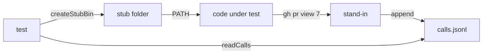

# Stub binaries

- **Status:** draft

`@zgeoff/testing/bin`, a subpath of the [testing kit](./README.md), writes a stand-in for a command,
such as `gh` or `op`, into a folder that a test puts first on `PATH`. The stand-in answers each call
from a list of answers that the test gives, or runs a script that the test gives, and records every
call to a log in that folder. When the test gives answers, a call that matches none of them exits 97
with its argv on stderr.

## Shape



## Contracts

```ts
// createTempDir is from @zgeoff/testing/fs; updateEnv is from @zgeoff/testing and restores PATH after the test
const bin = createTempDir('stub-bin').path;

const gh = createStubBin(bin, 'gh', {
  answers: [
    { args: ['pr', 'view'], stdout: '{"number":7}\n' },
    { args: ['pr', 'merge'], exitCode: 1, stderr: 'merge conflict\n' },
    { args: ['pr', 'merge'], stdout: '' }, // the second `gh pr merge` call succeeds
  ],
  recordEnv: ['GH_TOKEN'],
  recordStdin: true,
});
updateEnv('PATH', `${bin}:${process.env.PATH}`);

// …the code under test runs `gh pr view 7 --json number`…

gh.readCalls();
// → [{ name: 'gh', argv: ['pr', 'view', '7', '--json', 'number'], cwd: '/tmp/…/repo',
//      env: { GH_TOKEN: 'test-token' }, stdin: '' }]
```

```ts
const sudo = createStubBin(bin, 'sudo', { script: '#!/bin/sh\nexec "$@"\n' }); // runs the command it is given, as sudo would
const silent = createStubBin(bin, 'notify-send'); // every call exits 0 with no output
linkCommands(bin, ['git', 'jq']); // symlinks the real git and jq into bin, for a test that sets PATH to bin alone
readStubCalls(bin); // → every call to every stand-in in bin, in call order
```

```ts
// @zgeoff/testing/bin
function createStubBin(directory: string, name: string, options?: StubBinOptions): StubBin;
function readStubCalls(directory: string): readonly StubCall[]; // a folder with no log reads as []
function linkCommands(directory: string, names: readonly string[]): void; // throws on a name PATH lacks

// existing, and async: writes a sudo stand-in that exits 0 for `sudo -n true`, and appends each other call to the file at `record`
function createStubSudo(directory: string, record: string): Promise<void>;

type StubBinOptions =
  | {
      readonly answers?: readonly StubAnswer[]; // left out: every call exits 0; given, even as []: an unmatched call exits 97
      readonly recordEnv?: readonly string[]; // env names to copy into each call's record
      readonly recordStdin?: boolean; // default false
    }
  | {
      readonly script: string; // the test's script, with its own shebang, run in place of answers
      readonly recordEnv?: readonly string[];
      readonly recordStdin?: boolean;
    };

interface StubAnswer {
  readonly args: readonly string[]; // matches a call whose argv starts with these
  readonly exitCode?: number; // default 0
  readonly stdout?: string;
  readonly stderr?: string;
}

interface StubBin {
  readonly path: string; // <directory>/<name>
  readCalls(): readonly StubCall[]; // this stand-in's calls only
}

interface StubCall {
  readonly name: string;
  readonly argv: readonly string[]; // exactly as the stand-in received them
  readonly cwd: string;
  readonly env: Readonly<Record<string, string>>; // only the recordEnv names that were set
  readonly stdin: string; // '' without recordStdin; with it, all of stdin up to EOF, or '' when stdin is a terminal
}
```

## Constraints

- `createStubBin` writes each stand-in to a staged name in the same folder and renames it into
  place, so rewriting a stand-in that a process still runs never fails with `ETXTBSY`.
- A stand-in with answers is a Bun script whose shebang names `process.execPath`, with its answers
  in a JSON file beside it. It runs no shell, so the answer text reaches stdout and stderr byte for
  byte.
- The stand-in picks the first answer whose `args` prefix matches and that has not answered yet.
  When every matching answer has answered, the last matching one answers again.
- The stand-in keeps which answers have answered in a state file beside its answers file, and
  updates it under a lock, so two calls that run at the same time never both take the same unused
  answer.
- An unmatched call writes `unexpected: <name> <argv…>` to stderr, and exits 97 after the stand-in
  records it.
- Every stand-in in one folder appends to one `calls.jsonl` in that folder, one JSON object per
  call, so `readStubCalls` gives the order across commands.
- A `script` stand-in runs the test's script behind a wrapper that records the call first. With
  `recordStdin`, the wrapper reads stdin to EOF, records it, and passes the same bytes to the
  script.
- With `recordStdin`, the stand-in waits for EOF on stdin. Code under test that keeps stdin open
  makes the call hang until the test's own timeout ends the test.
- Calling `createStubBin` again for a name replaces that stand-in whole, answers or script, and
  resets its answer state. It keeps the call log.

## Decisions

- **An unmatched call fails with its own exit code, 97, and its argv on stderr.** A real command
  rarely exits 97, so a test's failure output shows that a stand-in refused the call, and which call
  it was.
- **Answers match by argv prefix.** A test names the subcommand it scripts and ignores flags it does
  not care about.
- **The functions are synchronous, apart from `createStubSudo`.** A test sets up its stand-ins
  before it runs the code under test, with no `await`.

## Builder decides

- The names of the staged file, the answers file, the state file and the wrapper.
- The lock that guards the state file.
- Whether `readCalls` reads the log on each call or caches it.
